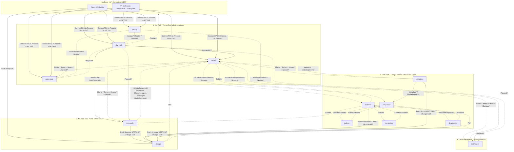

# mserver — Arquitetura de Módulos, Comunicação e Catálogo de Eventos

Este documento detalha a divisão interna dos módulos do **mserver**, o contexto (responsabilidade, dados próprios e projeções locais) de cada um, os padrões de comunicação (síncrona via ConnectRPC vs. assíncrona via ECST no `pubsub`) e o catálogo completo de eventos que garantem o funcionamento do sistema sem acoplamento de banco de dados.

---

## 1. Visão Geral da Arquitetura (Monolito Modular & Microserviços Distribuídos)

O **mserver** opera sob uma arquitetura híbrida que funciona tanto como **monolito autossuficiente** (ideal para Raspberry Pi e NAS modestos) quanto como **microserviços distribuídos** (onde o `storage` vive no NAS e os demais módulos escalam horizontalmente com Postgres, NATS e Valkey):

1. **Isolamento Total de Dados (SQLite por arquivo ou Postgres por Schema):**
   - Cada módulo que persiste estado possui seu próprio banco isolado (`<módulo>.db` no SQLite ou `SCHEMA <módulo>` no Postgres), com uma única implementação de queries SQL manuais diretamente em `store/` (queries base constantes em `store/queries.go`, placeholders `$1, $2`) e migrations separadas por dialeto (`store/migrations/sqlite` e `store/migrations/postgres`). Não há `JOIN` nem compartilhamento de tabelas entre módulos.
2. **Comunicação Síncrona via ConnectRPC + Protobuf (Zero-Copy In-Process no Monolito):**
   - Os contratos síncronos de todos os módulos são definidos em `proto/<módulo>/v1/<módulo>.proto` e compilados com `buf` (`protoc-gen-go` + `protoc-gen-connect-go`).
   - **No Monolito (`MSERVER_<MÓDULO>_URL` vazio):** os módulos comunicam-se via **`In-process transport` do Connect (`connectinprocess`)** com _Zero-Copy_ (`WithCopyFunc` retornando o mesmo ponteiro), trafegando puramente por ponteiros de memória sem serialização e sem TCP/HTTP loopback.
   - **Nos Microserviços (`MSERVER_<MÓDULO>_URL` definido):** os módulos comunicam-se via **HTTP/2 (`h2c`) no protocolo padrão do Connect** (Protobuf binário).
3. **Event-Carried State Transfer (ECST) Direto no `pubsub` (Sem Outbox):**
   - Módulos produtores publicam eventos contendo todo o estado necessário para que os módulos consumidores atualizem suas próprias projeções locais.
   - Para eliminar o dobro de escritas em disco/SD Card e a complexidade de propagar transações para uma outbox externa, os eventos são publicados diretamente no `pubsub.Publisher` após o commit da operação no banco:
     - No modo monolito (`pubsub/memory`), o barramento entrega em memória com retry assíncrono curto (_exponential backoff_) em caso de falha do handler.
     - No modo distribuído (`pubsub/nats`), o **NATS JetStream** persiste os eventos, descarta duplicatas nativamente via header `Nats-Msg-Id` (`UUIDv7`) e distribui a carga por módulo através de _Durable Consumers / Queue Groups_ (`consumer` na assinatura de `Subscribe`).
4. **Consistência Eventual Garantida com `Resync` Universal:**
   - Todo módulo produtor de estado expõe operações de `Resync` por contexto em seu serviço ConnectRPC.
   - O `Resync` lê os registros atuais do banco do módulo e republica os eventos correspondentes no `pubsub`.
   - Como todos os handlers de eventos são **idempotentes** (`UPSERT` baseado em ID), o `Resync` resolve _cold start_ (ex.: nova biblioteca cadastrada), recuperação após desligamento abrupto (`kill -9` / queda de energia entre o `COMMIT` e o `Publish`) e reconciliação periódica (`MSERVER_RESYNC_INTERVAL=24h`, ou incremental via `updated_at`).
5. **Apenas o `storage` Manipula Dados Físicos (Plano de Dados HTTP Puro):**
   - Nenhum outro módulo acessa o sistema de arquivos diretamente.
   - A transferência de bytes brutos de mídia (`GET` com `Range` / `206 Partial Content` usando `http.ServeContent` / `sendfile` zero-copy, e `PUT` para escrita de artefatos) ocorre **sempre via HTTP puro** diretamente no módulo `storage`, nunca por Protobuf/ConnectRPC ou NATS.
6. **Isolamento Total do Jellyfin e Governança de Conceitos (Regra Inegociável):**
   - **Todas as regras de negócio, conceitos, DTOs, unidades (como `.NET Ticks`), fluxos (`QuickConnect`, parse de `<user>#<profile>`, `DeviceProfile`/`PlaybackInfo`, `MediaSources`/`MediaStreams`/`DeliveryUrl`, `UserData`, protocolo `SyncPlay`) referentes ao Jellyfin devem estar 100% isolados no plugin `plugins/api/jellyfin`.**
   - **Nenhum conceito que não foi discutido deve estar fora do plugin do Jellyfin.**
   - **Tudo o que for preciso adicionar fora de `plugins/api/jellyfin` (nos contratos `.proto` dos módulos, bancos, eventos ou módulos internos) deve ser discutido antes.**

---

## 2. Planos Arquiteturais e Mapa de Comunicação

Os 13 módulos do sistema dividem-se em **4 planos**:

### Resumo de Comunicação Síncrona vs. Assíncrona

| Origem → Destino                                                | Tipo                                         | Quando e Por Quê                                                                                                                                                        |
| :-------------------------------------------------------------- | :------------------------------------------- | :---------------------------------------------------------------------------------------------------------------------------------------------------------------------- |
| `Surfaces` → `identity`, `library`, `watchstate`, `playback`    | **Síncrona (ConnectRPC: In-Proc / HTTP/2)**  | Responder às requisições dos clientes compondo dados globais (`library`) com dados do perfil (`watchstate` — Pós-MVP).                                                  |
| `plugins/api/jellyfin` → `storage`                              | **Síncrona (HTTP Range Proxy)**              | Proxy reverso em streaming de vídeo e legendas externas (`.srt`) para `GET /locations/{LocationID}/files/{FileID}` no `storage`.                                        |
| `library` → `storage.ResyncLocation`                            | **Síncrona (ConnectRPC: In-Proc / HTTP/2)**  | Disparar a republicação dos eventos `FileIndexed`/`FileAnalyzed` de uma `LocationID` quando uma biblioteca nova é cadastrada.                                           |
| `playback` → `library`                                          | **Síncrona (ConnectRPC: In-Proc / HTTP/2)**  | Obter as informações técnicas consolidadas do item para validar ou iniciar uma sessão de reprodução (pós-MVP).                                                          |
| `playback` → `transcoder.StartTranscode`                        | **Síncrona (ConnectRPC: In-Proc / HTTP/2)**  | Iniciar imediatamente o processo `ffmpeg` para entregar a playlist HLS ao player sem latência de fila.                                                                  |
| `transcoder`, `subtitles`, `metadata`, `downloader` → `storage` | **Síncrona (HTTP Puro `PUT` / `Range GET`)** | Gravar novos arquivos ou ler bytes (`Range`) no VFS sem serializar bytes em Protobuf.                                                                                   |
| **Todas as demais interações entre módulos**                    | **Assíncrona (Eventos via `pubsub`)**        | Indexação, `ffprobe`, catálogo, legendas, metadados, tradução, imagens, _trickplay_, controle `SIGSTOP`/`SIGCONT` do transcode, `watchstate`, aquisição e notificações. |

---

## 3. Contexto Detalhado de Cada Módulo

### 3.1 `storage` (Plano de Dados e Análise Física — MVP)

- **Responsabilidade:** Único dono do sistema de arquivos (VFS), podendo rodar isolado diretamente no NAS. Gerencia localizações (`media` no MVP; `cache`, `transcodes`, `images` no pós-MVP), atribui `FileID` (UUIDv7) estável (com detecção de move por `inode` e, no futuro, por hash), serve bytes via HTTP puro (`GET /locations/{LocationID}/files/{FileID}` com `Range` no MVP; `PUT` no pós-MVP) e executa analisadores físicos sobre os arquivos (`ffprobe` no MVP; `sha256` e `ed2k` no pós-MVP).
- **Dados próprios (SQLite / Postgres):** `locations`, `files` (`id`, `location_id`, `path`, `dir`, `size`, `mod_time`, `inode`), `file_analyses` (`file_id`, `analyzer`, `version`, `size`, `mod_time`, `result`, `error`, `analyzed_at`).
- **Projeções de outros módulos:** Nenhuma.
- **Comunicação:**
  - Recebe chamadas síncronas ConnectRPC (`CreateLocation`, `ListLocations`, `DeleteLocation`, `GetFile`, `ResolveFile`, `ResyncLocation`) e requisições HTTP puras no plano de dados (`GET`/`HEAD`/`PUT /locations/{LocationID}/files/{FileID}`).
  - Emite eventos `storage.file.*` no `pubsub` sempre que arquivos são indexados, alterados, movidos, removidos ou analisados.

### 3.2 `identity` (Contas, Perfis e Autenticação — MVP)

- **Responsabilidade:** Gerenciar a separação estilo Netflix entre **Contas (`Account`)** e **Perfis (`Profile`)**, dispositivos registrados, sessões de autenticação e tokens de acesso (com suporte a SSO OIDC no pós-MVP):
  - **Conta (`AccountID`):** detém credenciais de autenticação (`username`, `email`, `password_hash`, `is_admin`, `disabled` e, no futuro, vínculo SSO OIDC).
  - **Perfil (`ProfileID`):** pertence a uma conta (`account_id`), mas possui identidade própria (`profile_id`), identificador curto único dentro da conta (`handle`), nome de exibição (`display_name`) e imagem restrita ao perfil (`avatar_file_id` no futuro).
  - **Isolamento das regras do Jellyfin em `plugins/api/jellyfin`:** O módulo `identity` não conhece sintaxes ou protocolos do Jellyfin. O mapeamento `User` (Jellyfin) ↔ `Profile` (`ProfileID`), o parse da string concatenada `<username ou email>#<profile>` enviada no `POST /Users/AuthenticateByName` e a máquina de estados do fluxo **QuickConnect** ficam isolados em `plugins/api/jellyfin`.
- **Dados próprios (SQLite / Postgres):**
  - `accounts`, `profiles`, `devices`, `sessions`.
- **Projeções de outros módulos:** Nenhuma.
- **Comunicação:**
  - Consultado pelas Surfaces via ConnectRPC para autenticação, gerenciamento e validação de tokens.
  - Emite eventos de ciclo de vida de contas, perfis e sessões (`Account*`, `ProfileCreated`, `ProfileUpdated`, `ProfileTransferred`, `ProfileDeleted`, `SessionRevoked`) no `pubsub`.

### 3.3 `library` (Catálogo Materializado Global)

- **Responsabilidade:** Manter o catálogo global de mídia (`Library`, `Movie`, `Series`, `Season`, `Episode`), 100% independente de usuários (altamente cacheável) e livre de conceitos do Jellyfin. Identifica itens aplicando regex sobre os caminhos relativos vindos do `storage` e agrega as informações técnicas e enriquecimentos vindos dos demais módulos em seu modelo de domínio próprio.
- **Dados próprios (SQLite / Postgres):**
  - `libraries` e `library_locations` (`library_id`, `location_id`).
  - `movies`, `series`, `seasons`, `episodes`.
- **Dados consolidados via Eventos (ECST):**
  - Informações técnicas de streams e capítulos (recebidos de `storage.file.analyzed.v1` via analisador `ffprobe`).
  - Legendas externas (recebidas de `subtitles.subtitle.added.v1` e `transcoder.subtitle.converted.v1`).
  - Segmentos de mídia e imagens (pós-MVP).
- **Comunicação:**
  - Não chama nenhum módulo no caminho crítico de leitura.
  - Ao cadastrar uma biblioteca, invoca `storage.ResyncLocation` via ConnectRPC.
  - Emite eventos de catálogo (`Movie*`, `Series*`, `Season*`, `Episode*`) no `pubsub`.

### 3.4 `watchstate` (Estado de Consumo por Perfil e Histórico — Pós-MVP)

- **Responsabilidade:** Gerenciar tudo o que relaciona um **`ProfileID`** a um **`ItemID`**: progresso atual, estado de assistido, favoritos, filas de continuar assistindo e próximos episódios, contadores de não assistidos e o histórico cronológico completo de sessões assistidas (_Watch History_).
- **Projeções locais (via ECST):**
  - Topologia do catálogo (`Series → Season → Episode`) alimentada pelos eventos da `library`.
- **Comunicação:**
  - Escuta eventos da `library`, do `playback` e do `identity` (consumer group `"watchstate"`).
  - Consultado pelas Surfaces via ConnectRPC.

### 3.5 `playback` (Sessões de Reprodução em Tempo Real e Salas Compartilhadas — MVP)

- **Responsabilidade:** Manter o estado das sessões de reprodução ativas, decidir sobre reprodução direta ou transcode (no pós-MVP), detectar sessões abandonadas por timeout e emitir eventos de ciclo de vida da reprodução. No pós-MVP, coordena também salas de reprodução sincronizada protegidas por código de acesso.
- **Isolamento das regras do Jellyfin em `plugins/api/jellyfin`:**
  - A interpretação de `DeviceProfile` e montagem de `PlaybackInfoResponse` pertencem ao `plugins/api/jellyfin`.
  - No pós-MVP, a adaptação das salas compartilhadas para o protocolo `SyncPlay` do Jellyfin (`/SyncPlay/*` e WebSocket `/socket`) fica isolada em `plugins/api/jellyfin`.
- **Dados próprios:**
  - Sessões ativas (e salas compartilhadas no pós-MVP) exclusivamente no `kv.Store` compartilhado (`internal/kv`): chave `sessions/{PlaybackSessionID}`, valor JSON, TTL de 2× o timeout de inatividade. No monolito a implementação é `kv/memory`; nos microserviços com `kv/valkey`, múltiplas instâncias do `playback` compartilham as sessões sem precisar de banco SQL no módulo `playback`.
- **Comunicação:**
  - No MVP não chama nenhum módulo (`ItemID`/`FileID` chegam do chamador). No pós-MVP, chama `library` e `transcoder.StartTranscode` via ConnectRPC.
  - Emite eventos de sessão (`PlaybackStarted`, `PlaybackProgressed`, `PlaybackPaused`, `PlaybackResumed`, `PlaybackStopped`) diretamente no `pubsub`.

### 3.6 `subtitles` (Legendas Locais `.srt` no MVP e Provedores Externos no Pós-MVP)

- **Responsabilidade:** Descobrir e associar legendas externas locais `.srt` aos itens da biblioteca (no MVP) e suportar outros formatos e busca de legendas faltantes em provedores externos como OpenSubtitles/Subdl (no Pós-MVP).
- **Dados próprios (SQLite / Postgres):**
  - `subtitle_files` (`file_id`, `location_id`, `path`, `format`, `language`, `is_forced`, `is_hearing_impaired`) — populada via `storage.file.indexed.v1`.
  - `matched_subtitles` (`subtitle_id`, `item_id`, `file_id`, `converted_vtt_file_id`, `language`, `format`, `source`).
- **Projeções locais (via ECST):**
  - `media_items` (`item_id`, `item_type`, `file_id`, `location_id`, `video_path`, `title`, `year`, `series_title`, `season_number`, `episode_number`) — populada pelos eventos `MovieAdded`/`EpisodeAdded` da `library`.
- **Comunicação:**
  - Faz o match bidirecional sempre sobre sua projeção local: tanto quando chega `FileIndexed` de uma legenda quanto quando chega `MovieAdded`/`EpisodeAdded` de um vídeo.
  - Quando encontra uma legenda, emite `SubtitleAdded` no `pubsub` para que a `library` a associe ao item.

### 3.7 `transcoder` (Execução do FFmpeg em Tempo Real e em Background — Pós-MVP)

- **Responsabilidade:** Executar todos os processos `ffmpeg` do sistema, divididos em duas filas com controle de prioridade via sinais POSIX (`SIGSTOP`, `SIGCONT`, `SIGTERM`):
  1. **Fila Realtime (HLS):** Iniciada de forma síncrona por `StartTranscode` (ConnectRPC). Monitora a posição do cliente via eventos do `playback`.
  2. **Fila Background (Baixa Prioridade):** Reage a eventos da `library` e do `subtitles` para converter legendas, extrair frames, gerar imagens de capítulos, _trickplay_ e detectar aberturas/créditos.
- **Dados próprios (SQLite / Postgres):** `transcode_jobs`.
- **Comunicação:**
  - Lê mídia via HTTP `Range` do `storage` e grava artefatos de forma síncrona via HTTP `PUT` no `storage`.
  - Emite eventos de conclusão no `pubsub`.

### 3.8 `metadata` (Provedores de Metadados, Artes e Segmentos — Futuro)

- **Responsabilidade:** Consultar provedores externos (TMDB, TVDB, AniDB, Fanart.tv, AniSkip, IntroDB) para enriquecer sinopses, elenco, notas, títulos oficiais, IDs externos, imagens e segmentos de mídia.
- **Projeções locais (via ECST):** Cópia dos itens da `library` e hashes de arquivos.
- **Comunicação:**
  - Baixa imagens externas, salva de forma síncrona via HTTP `PUT` no `storage` (classe `images`) e emite `MetadataUpdated`, `ImagesUpdated` e `MediaSegmentsUpdated`.

### 3.9 `acquisition`, `indexer` e `downloader` (Pipeline de Aquisição — Futuro)

- **`acquisition`:** Mantém os itens monitorados, perfis de qualidade e coordena buscas e downloads por eventos.
- **`indexer`:** Gerencia plugins de indexers (Torznab, Newznab, Cardigann). Escuta `ReleaseSearchRequested` e emite `ReleasesFound`.
- **`downloader`:** Gerencia plugins de clientes de download (qBittorrent, Transmission, SABnzbd). Escuta `DownloadRequested` e importa os arquivos concluídos no `storage`, emitindo `DownloadCompleted`.

### 3.10 `translation` (Tradução de Legendas — Futuro)

- **Responsabilidade:** Traduzir legendas automaticamente usando plugins de tradução (LLMs, DeepL, LibreTranslate).

### 3.11 `notification` (Notificações e Webhooks — Futuro)

- **Responsabilidade:** Reagir aos eventos relevantes de todos os módulos e disparar alertas externos (Webhooks, Discord, Telegram, Push).

---

## 4. Catálogo Completo de Eventos

Todos os eventos trafegam no envelope **CloudEvents 1.0** (`pubsub.Envelope[T]`):

- `id`: UUIDv7 (monótono, passado também em `pubsub.Message.ID` e usado como `Nats-Msg-Id` para deduplicação nativa no NATS JetStream e nos consumidores)
- `source`: nome do módulo emissor
- `type`: nome versionado do evento (também usado como tópico no `pubsub`)
- `time`: timestamp UTC
- `subject`: ID do recurso principal ao qual o evento se refere
- `data`: payload JSON tipado definido no pacote `events/` do módulo de origem (ex.: `storage/events.FileEventV1`)

> **Importante:** Nenhum conceito ou unidade do Jellyfin (como `Ticks`, `UserData`, `SyncPlay` ou `MediaSources`) deve fazer parte dos payloads de eventos internos. Além disso, os campos exatos de `data` de cada módulo ainda não implementado são uma referência inicial e **devem ser discutidos antes** de serem definidos em código no pacote `events/` do respectivo módulo.

---

### 4.1 Eventos emitidos pelo `storage`

| Tópico (`type`)            | `subject` | Consumidores                         | Quando é disparado                                                        | Campos em `data`                                                                                                                                                                                                                                                                                                                                 |
| :------------------------- | :-------- | :----------------------------------- | :------------------------------------------------------------------------ | :----------------------------------------------------------------------------------------------------------------------------------------------------------------------------------------------------------------------------------------------------------------------------------------------------------------------------------------------- |
| `storage.file.indexed.v1`  | `FileID`  | `library`, `subtitles`               | Novo arquivo registrado no VFS (ou republicado via `Resync`).             | `file_id`, `location_id`, `path` (relativo à localização) — `storage/events.FileEventV1`                                                                                                                                                                                                                                                         |
| `storage.file.changed.v1`  | `FileID`  | `library`, `subtitles`               | Arquivo no mesmo `path` mudou de tamanho, `mtime` ou `inode`.             | `file_id`, `location_id`, `path`                                                                                                                                                                                                                                                                                                                 |
| `storage.file.moved.v1`    | `FileID`  | `library`, `subtitles`               | Arquivo renomeado/movido mantendo o mesmo `FileID` (via `inode` ou hash). | `file_id`, `location_id`, `path`                                                                                                                                                                                                                                                                                                                 |
| `storage.file.removed.v1`  | `FileID`  | `library`, `subtitles`, `transcoder` | Arquivo removido do disco, localização apagada ou TTL expirado.           | `file_id`, `location_id`, `path` (último caminho conhecido)                                                                                                                                                                                                                                                                                      |
| `storage.file.analyzed.v1` | `FileID`  | `library`, `metadata`, `subtitles`   | Conclusão de um analisador (`ffprobe`; no futuro `sha256`, `ed2k`).       | `file_id`, `location_id`, `analyzer`, `version` e `result` — `storage/events.FileAnalyzedEventV1`. O formato de `result` depende do analisador e da versão: `ffprobe` v1 é `storage/events.FFprobeResultV1` (`container`, `duration_ms`, `bit_rate`, `size`, `streams[]`; capítulos no pós-MVP). Falhas causadas pelo arquivo não são publicadas |

---

### 4.2 Eventos emitidos pelo `identity`

| Tópico (`type`)                   | `subject`   | Consumidores                             | Quando é disparado                                                                                                           | Campos de referência em `data` (a discutir antes de implementar)                                |
| :-------------------------------- | :---------- | :--------------------------------------- | :--------------------------------------------------------------------------------------------------------------------------- | :---------------------------------------------------------------------------------------------- |
| `identity.account.created.v1`     | `AccountID` | `notification`                           | Nova conta criada (ou via `Resync`).                                                                                         | `account_id`, `username`, `email`, `is_admin`, `created_at`                                     |
| `identity.account.updated.v1`     | `AccountID` | `notification`                           | Dados, credenciais ou permissões da conta alterados.                                                                         | `account_id`, `username`, `email`, `is_admin`, `disabled`, `updated_at`                         |
| `identity.account.deleted.v1`     | `AccountID` | `playback`, `notification`               | Conta removida do sistema (perfis não migrados são removidos junto via `profile.deleted`).                                   | `account_id`                                                                                    |
| `identity.profile.created.v1`     | `ProfileID` | `watchstate`, `notification`             | Novo perfil criado dentro de uma conta (ou via `Resync`).                                                                    | `profile_id`, `account_id`, `handle`, `display_name`, `avatar_file_id` (opcional), `created_at` |
| `identity.profile.updated.v1`     | `ProfileID` | `watchstate`, `notification`             | Nome, `handle` ou avatar do perfil alterados.                                                                                | `profile_id`, `account_id`, `handle`, `display_name`, `avatar_file_id` (opcional), `updated_at` |
| `identity.profile.transferred.v1` | `ProfileID` | `playback`, `notification`               | (Futuro) Perfil migrado de uma conta para outra (histórico no `watchstate` permanece intacto pois é ligado ao `profile_id`). | `profile_id`, `from_account_id`, `to_account_id`, `handle`, `transferred_at`                    |
| `identity.profile.deleted.v1`     | `ProfileID` | `watchstate`, `playback`, `notification` | Perfil removido permanentemente (`watchstate` apaga o histórico e estado do perfil).                                         | `profile_id`, `account_id`                                                                      |
| `identity.session.revoked.v1`     | `SessionID` | `playback`, `Surfaces`                   | Logout ou revogação de sessão/token.                                                                                         | `session_id`, `account_id`, `profile_id`, `device_id`, `revoked_at`                             |

---

### 4.3 Eventos emitidos pela `library`

| Tópico (`type`)              | `subject`   | Consumidores                                                                       | Quando é disparado                                                                     | Campos de referência em `data` (a discutir antes de implementar)                                                                                                                                                                                                                                                                    |
| :--------------------------- | :---------- | :--------------------------------------------------------------------------------- | :------------------------------------------------------------------------------------- | :---------------------------------------------------------------------------------------------------------------------------------------------------------------------------------------------------------------------------------------------------------------------------------------------------------------------------------- |
| `library.movie.added.v1`     | `MovieID`   | `subtitles`, `watchstate`, `transcoder`, `metadata`, `acquisition`, `notification` | Filme identificado (ou via `Resync`).                                                  | `movie_id`, `library_id`, `file_id`, `location_id`, `path`, `title`, `year` (omitido se desconhecido), `duration_ms` (omitido até a análise do `ffprobe`) — `library/events.MovieEventV1`; `chapters[]` no pós-MVP                                                                                                                  |
| `library.movie.updated.v1`   | `MovieID`   | `subtitles`, `watchstate`, `transcoder`, `metadata`, `acquisition`                 | Reidentificação do filme, chegada da análise do `ffprobe` ou atualização de vínculo.   | Mesmos campos de `library.movie.added.v1`                                                                                                                                                                                                                                                                                           |
| `library.movie.removed.v1`   | `MovieID`   | `subtitles`, `watchstate`, `transcoder`, `metadata`, `acquisition`                 | Arquivo do filme foi removido ou biblioteca apagada.                                   | `movie_id`, `library_id`, `file_id` — `library/events.MovieRemovedEventV1`                                                                                                                                                                                                                                                          |
| `library.series.added.v1`    | `SeriesID`  | `watchstate`, `metadata`, `acquisition`, `notification`                            | Nova série lógica criada na biblioteca (ou via `Resync`).                              | `series_id`, `library_id`, `title`, `year` (omitido se desconhecido) — `library/events.SeriesEventV1`                                                                                                                                                                                                                               |
| `library.series.updated.v1`  | `SeriesID`  | `watchstate`, `metadata`, `acquisition`                                            | Série atualizada (ainda não emitido: a série é casada por título e ano normalizados).  | `series_id`, `library_id`, `title`, `year` — `library/events.SeriesEventV1`                                                                                                                                                                                                                                                         |
| `library.series.removed.v1`  | `SeriesID`  | `watchstate`, `metadata`, `acquisition`                                            | Série ficou sem temporadas/episódios e foi removida, ou biblioteca apagada.            | `series_id`, `library_id` — `library/events.SeriesRemovedEventV1`                                                                                                                                                                                                                                                                   |
| `library.season.added.v1`    | `SeasonID`  | `watchstate`, `metadata`, `acquisition`                                            | Nova temporada lógica criada em uma série (ou via `Resync`).                           | `season_id`, `series_id`, `library_id`, `season_number` (`0` = especiais) — `library/events.SeasonEventV1`                                                                                                                                                                                                                          |
| `library.season.removed.v1`  | `SeasonID`  | `watchstate`, `metadata`, `acquisition`                                            | Temporada ficou sem episódios e foi removida, ou biblioteca apagada.                   | `season_id`, `series_id`, `library_id`, `season_number` — `library/events.SeasonEventV1`                                                                                                                                                                                                                                            |
| `library.episode.added.v1`   | `EpisodeID` | `subtitles`, `watchstate`, `transcoder`, `metadata`, `acquisition`, `notification` | Episódio identificado (ou via `Resync`).                                               | `episode_id`, `library_id`, `series_id`, `series_title`, `series_year`, `season_id`, `season_number`, `episode_number` e `episode_end_number` (omitidos se desconhecidos), `title`, `file_id`, `location_id`, `path`, `duration_ms` (omitido até a análise do `ffprobe`) — `library/events.EpisodeEventV1`; `chapters[]` no pós-MVP |
| `library.episode.updated.v1` | `EpisodeID` | `subtitles`, `watchstate`, `transcoder`, `metadata`, `acquisition`                 | Episódio mudou de número/temporada/série ou recebeu informações técnicas do `ffprobe`. | Mesmos campos de `library.episode.added.v1`                                                                                                                                                                                                                                                                                         |
| `library.episode.removed.v1` | `EpisodeID` | `subtitles`, `watchstate`, `transcoder`, `metadata`, `acquisition`                 | Arquivo do episódio foi removido ou biblioteca apagada.                                | `episode_id`, `library_id`, `series_id`, `season_id`, `file_id` — `library/events.EpisodeRemovedEventV1`                                                                                                                                                                                                                            |

Ordem de publicação no `service`: `series.added` → `season.added` → `episode.added`; na remoção, `episode.removed` → `season.removed` → `series.removed`.

---

### 4.4 Eventos emitidos pelo `playback`

| Tópico (`type`)                  | `subject`           | Consumidores                               | Quando é disparado                                                                            | Campos em `data`                                                                                                                                                                                                    |
| :------------------------------- | :------------------ | :----------------------------------------- | :-------------------------------------------------------------------------------------------- | :------------------------------------------------------------------------------------------------------------------------------------------------------------------------------------------------------------------ |
| `playback.session.started.v1`    | `PlaybackSessionID` | `watchstate`, `notification`               | Perfil iniciou a reprodução de um item.                                                       | `playback_session_id`, `account_id`, `profile_id`, `device_id`, `item_id`, `file_id`, `play_method`, `position_ms`, `sequence`, `started_at` — `playback/events.SessionStartedEventV1`                              |
| `playback.session.progressed.v1` | `PlaybackSessionID` | `watchstate`, `transcoder`                 | Atualização periódica da posição de reprodução.                                               | `playback_session_id`, `profile_id`, `device_id`, `item_id`, `position_ms`, `is_paused`, `sequence`, `reported_at` — `playback/events.SessionProgressedEventV1`                                                     |
| `playback.session.paused.v1`     | `PlaybackSessionID` | `watchstate`, `transcoder`                 | Perfil pausou a reprodução (`transcoder` usa para agendar/aplicar `SIGSTOP`).                 | `playback_session_id`, `profile_id`, `item_id`, `position_ms`, `sequence`, `paused_at` — `playback/events.SessionPausedEventV1`                                                                                     |
| `playback.session.resumed.v1`    | `PlaybackSessionID` | `watchstate`, `transcoder`                 | Perfil retomou a reprodução (`transcoder` usa para enviar `SIGCONT`).                         | `playback_session_id`, `profile_id`, `item_id`, `position_ms`, `sequence`, `resumed_at` — `playback/events.SessionResumedEventV1`                                                                                   |
| `playback.session.stopped.v1`    | `PlaybackSessionID` | `watchstate`, `transcoder`, `notification` | Reprodução encerrada pelo usuário ou por timeout de heartbeat (`transcoder` envia `SIGTERM`). | `playback_session_id`, `account_id`, `profile_id`, `device_id`, `item_id`, `position_ms`, `watched_duration_ms`, `sequence`, `stopped_at`, `reason` (`user` \| `timeout`) — `playback/events.SessionStoppedEventV1` |

`sequence` é crescente por sessão e permite aos consumidores descartar eventos fora de ordem.

---

### 4.5 Eventos emitidos pelo `watchstate` (Pós-MVP)

| Tópico (`type`)               | `subject` | Consumidores                                     | Quando é disparado                                                                           | Campos de referência em `data` (a discutir antes de implementar)                                                                                    |
| :---------------------------- | :-------- | :----------------------------------------------- | :------------------------------------------------------------------------------------------- | :-------------------------------------------------------------------------------------------------------------------------------------------------- |
| `watchstate.state.updated.v1` | `ItemID`  | `notification` (e futuros plugins Trakt/AniList) | Mudança no estado do item para o perfil (posição salva, marcado como assistido ou favorito). | `profile_id`, `item_id`, `played`, `play_count`, `position`, `last_played_at`, `is_favorite`, `updated_at`                                          |
| `watchstate.item.watched.v1`  | `ItemID`  | `notification` (e plugins de scrobble)           | Perfil concluiu a visualização de um filme ou episódio.                                      | `history_id`, `profile_id`, `item_id`, `item_type`, `series_id` (opcional), `season_number` (opcional), `episode_number` (opcional), `completed_at` |

---

### 4.6 Eventos emitidos pelo `subtitles` e pelo `translation`

| Tópico (`type`)                      | `subject`    | Consumidores                                           | Quando é disparado                                                                               | Campos de referência em `data` (a discutir antes de implementar)                                                                                                                         |
| :----------------------------------- | :----------- | :----------------------------------------------------- | :----------------------------------------------------------------------------------------------- | :--------------------------------------------------------------------------------------------------------------------------------------------------------------------------------------- |
| `subtitles.subtitle.added.v1`        | `SubtitleID` | `library`, `transcoder`, `translation`, `notification` | Legenda local associada a um item (ou legenda baixada/traduzida gravada no `storage`).           | `subtitle_id`, `item_id`, `item_type`, `file_id`, `format` (`srt`, `vtt`, `ass`, `ssa`, `sub`), `language` (BCP-47, ex.: `pt-BR`), `title`, `is_forced`, `is_hearing_impaired`, `source` |
| `subtitles.subtitle.removed.v1`      | `SubtitleID` | `library`, `transcoder`                                | Arquivo de legenda removido ou desassociado do item.                                             | `subtitle_id`, `item_id`, `file_id`                                                                                                                                                      |
| `subtitles.translation.requested.v1` | `SubtitleID` | `translation`                                          | (Futuro) Nenhuma legenda no idioma alvo foi achada, mas há legenda em idioma base para traduzir. | `subtitle_id`, `item_id`, `source_file_id`, `source_language`, `target_language`, `format`                                                                                               |
| `translation.subtitle.translated.v1` | `SubtitleID` | `subtitles`                                            | (Futuro) `translation` concluiu a tradução e salvou o novo arquivo no `storage`.                 | `source_subtitle_id`, `item_id`, `translated_file_id`, `target_language`, `format`, `provider`                                                                                           |

---

### 4.7 Eventos emitidos pelo `transcoder` (Pós-MVP)

| Tópico (`type`)                          | `subject`    | Consumidores           | Quando é disparado                                                                                         | Campos de referência em `data` (a discutir antes de implementar)                                                                                           |
| :--------------------------------------- | :----------- | :--------------------- | :--------------------------------------------------------------------------------------------------------- | :--------------------------------------------------------------------------------------------------------------------------------------------------------- |
| `transcoder.subtitle.converted.v1`       | `SubtitleID` | `library`, `subtitles` | Legenda externa (`.srt`/`.ass`) ou embutida foi convertida para `.vtt` e salva no `storage` (`cache`).     | `subtitle_id`, `item_id`, `source_file_id`, `converted_file_id`, `format` (`vtt`)                                                                          |
| `transcoder.thumbnail.extracted.v1`      | `ItemID`     | `library`              | (Pós-MVP) Frame de prévia de um episódio/filme foi extraído pelo `ffmpeg` e salvo no `storage` (`images`). | `item_id`, `image_file_id`, `width`, `height`, `timestamp`                                                                                                 |
| `transcoder.chapter_images.extracted.v1` | `ItemID`     | `library`              | (Pós-MVP) Frames de todos os capítulos de um item foram extraídos e salvos no `storage` (`images`).        | `item_id`, `chapters[]` (`chapter_index`, `image_file_id`, `width`, `height`, `timestamp`)                                                                 |
| `transcoder.trickplay.generated.v1`      | `ItemID`     | `library`              | (Pós-MVP) Sprites de _trickplay_ (prévia na barra de busca) gerados e salvos no `storage` (`images`).      | `item_id`, `width`, `height`, `tile_width`, `tile_height`, `thumbnail_count`, `interval_ms`, `sprite_file_ids[]`                                           |
| `transcoder.media_segments.detected.v1`  | `ItemID`     | `library`              | (Pós-MVP) Intervalos de abertura/encerramento detectados via análise de áudio (`chromaprint`) ou vídeo.    | `item_id`, `series_id` (opcional), `season_id` (opcional), `segments[]` (`type`: `intro` \| `outro` \| `recap` \| `preview`, `start`, `end`, `confidence`) |

---

### 4.8 Eventos emitidos pelo `metadata` (Futuro)

| Tópico (`type`)                      | `subject` | Consumidores             | Quando é disparado                                                                        | Campos de referência em `data` (a discutir antes de implementar)                                                                                                                                                                                                                                                                                                                                        |
| :----------------------------------- | :-------- | :----------------------- | :---------------------------------------------------------------------------------------- | :------------------------------------------------------------------------------------------------------------------------------------------------------------------------------------------------------------------------------------------------------------------------------------------------------------------------------------------------------------------------------------------------------ |
| `metadata.item.updated.v1`           | `ItemID`  | `library`, `acquisition` | Metadados textuais e identificadores externos obtidos dos provedores (TMDB, TVDB, AniDB). | `item_id`, `item_type` (`movie`, `series`, `season`, `episode`), `official_title`, `original_title`, `sort_title`, `overview`, `premiere_date`, `year`, `community_rating`, `official_rating`, `genres[]`, `studios[]`, `people[]`, `external_ids` (mapa `tmdb`, `tvdb`, `imdb`, `anidb`), `series_episodes_catalog[]` (quando `series`: lista de temporadas/episódios existentes para o `acquisition`) |
| `metadata.images.updated.v1`         | `ItemID`  | `library`                | Imagens baixadas dos provedores externos e salvas no `storage` (`images`).                | `item_id`, `item_type`, `images[]` (`image_type`: `primary` \| `backdrop` \| `logo` \| `banner` \| `thumb`, `file_id`, `width`, `height`, `language`)                                                                                                                                                                                                                                                   |
| `metadata.media_segments.updated.v1` | `ItemID`  | `library`                | Timestamps de abertura/encerramento obtidos de bases externas (ex.: AniSkip, IntroDB).    | `item_id`, `provider`, `segments[]` (`type`: `intro` \| `outro` \| `recap` \| `preview`, `start`, `end`)                                                                                                                                                                                                                                                                                                |

---

### 4.9 Eventos emitidos por `acquisition`, `indexer` e `downloader` (Futuro)

| Tópico (`type`)                     | `subject`  | Emissor → Consumidores                       | Quando é disparado                                                                                         | Campos obrigatórios em `data`                                                                                                                                                                |
| :---------------------------------- | :--------- | :------------------------------------------- | :--------------------------------------------------------------------------------------------------------- | :------------------------------------------------------------------------------------------------------------------------------------------------------------------------------------------- |
| `acquisition.search.requested.v1`   | `SearchID` | `acquisition` → `indexer`                    | `acquisition` identificou um filme ou episódio monitorado faltante (ou elegível para upgrade).             | `search_id`, `target_type` (`movie`, `episode`, `season_pack`), `title`, `alternative_titles[]`, `year`, `season_number`, `episode_number`, `external_ids` (`imdb`, `tvdb`, `tmdb`, `anidb`) |
| `indexer.releases.found.v1`         | `SearchID` | `indexer` → `acquisition`                    | `indexer` concluiu a busca nos plugins Torznab/Newznab configurados.                                       | `search_id`, `releases[]` (`guid`, `indexer_id`, `title`, `size`, `download_url`, `magnet_url`, `info_hash`, `seeders`, `peers`, `publish_date`, `protocol`: `torrent` \| `usenet`)          |
| `acquisition.download.requested.v1` | `GrabID`   | `acquisition` → `downloader`, `notification` | Motor de decisão do `acquisition` aprovou um release dentro do perfil de qualidade.                        | `grab_id`, `target_item_id`, `library_id`, `destination_location_id`, `destination_relative_dir`, `release_title`, `protocol`, `download_url`, `magnet_url`                                  |
| `downloader.download.completed.v1`  | `GrabID`   | `downloader` → `acquisition`, `notification` | Cliente de download terminou e o `downloader` importou (hardlink/copy/move) o arquivo para o `storage`.    | `grab_id`, `target_item_id`, `library_id`, `files[]` (`file_id`, `location_id`, `path`, `size`), `completed_at`                                                                              |
| `downloader.download.failed.v1`     | `GrabID`   | `downloader` → `acquisition`, `notification` | Falha no cliente de download (permite ao `acquisition` colocar o release em blocklist e tentar o próximo). | `grab_id`, `target_item_id`, `release_title`, `error_message`, `failed_at`                                                                                                                   |
