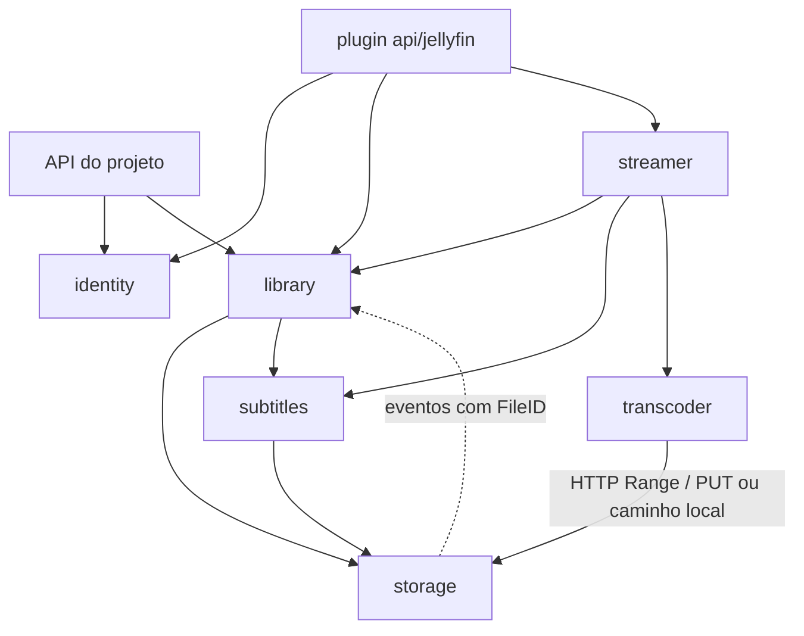

# mserver — Planejamento

Documento de resumo das decisões de arquitetura e do roadmap do projeto.
Decisões abertas estão listadas ao final e devem ser registradas aqui (ou
em ADRs em `docs/adr/`) assim que forem tomadas.

## 1. Visão geral

O **mserver** é um servidor de mídia escrito em Go que pretende substituir,
em um único projeto:

| Ferramenta | Papel no mserver                                      |
| ---------- | ----------------------------------------------------- |
| Jellyfin   | Biblioteca, streaming e transcode (prioridade máxima) |
| Sonarr     | Aquisição de séries                                   |
| Radarr     | Aquisição de filmes                                   |
| Prowlarr   | Gerenciamento de indexers                             |
| Bazarr     | Legendas                                              |
| Lingarr    | Tradução de legendas                                  |

O software pode ser executado como **monolito** (todos os módulos em um único
processo) ou, no futuro, como **microserviços** (cada módulo, ou grupo de
módulos, em uma instância diferente), a partir do mesmo binário.

## 2. Princípios

1. **Monolito modular com fronteiras rígidas.** Cada módulo é isolado
   logicamente e pode ser extraído para outra instância sem reescrita.
2. **Recursos isolados por módulo.** Cada módulo tem seu próprio banco,
   migrations, cache e filas. Não existe JOIN entre módulos; referências
   entre módulos são feitas apenas por ID.
3. **Autossuficiente.** Por padrão tudo roda localmente, sem dependências de
   infraestrutura externa (SQLite, cache em memória, fila em memória/outbox,
   disco local).
4. **Infraestrutura atrás de interfaces.** Mesmo com uma única
   implementação, a infra é acessada via interface para permitir novos
   backends no futuro. Pastas de backends ainda não implementados (ex.:
   `redis/`, `nats/`) **não** devem ser criadas antecipadamente.
5. **Compatibilidade com Jellyfin antes de UI própria.** Os clientes
   oficiais do Jellyfin são a interface de reprodução; a administração é
   feita via API (curl/Bruno) até existir uma interface web.
6. **Processamento multimídia exclusivamente pela suíte FFmpeg.** Probe,
   transcode, geração de imagens, conversão de legendas e qualquer outro
   processamento de mídia usam os binários `ffprobe`/`ffmpeg` disponíveis
   no ambiente, executados como processos externos.
7. **Interfaces Go hoje, gRPC amanhã.** A comunicação entre módulos começa
   com interfaces Go in-process, mas todo contrato é escrito para permitir
   a migração para gRPC sem alterar os consumidores (ver seção 4).

## 3. Decisões de arquitetura

| Tema                          | Decisão                                                                                                                   |
| ----------------------------- | ------------------------------------------------------------------------------------------------------------------------- |
| Linguagem                     | Go 1.27.3                                                                                                                 |
| Modo de execução              | Mesmo binário; módulos habilitados via configuração/variáveis de ambiente                                                 |
| Comunicação entre módulos     | **Agora:** interfaces Go in-process. **Futuro:** gRPC (`bufconn` no monolito, TCP quando distribuído)                     |
| Contratos entre módulos       | **Agora:** pacote `api/` de cada módulo. **Futuro:** `.proto` gerenciados com `buf`                                       |
| Plano de dados (bytes)        | HTTP servido pelo módulo `storage` (com `Range`/`PUT`); bytes nunca trafegam pelos contratos                              |
| Descoberta de serviços        | Endereços fixos definidos por variáveis de ambiente (quando houver módulos remotos)                                       |
| Banco de dados                | SQLite, um arquivo por módulo, migrations embutidas (`go:embed`)                                                          |
| Cache                         | Em memória                                                                                                                |
| Filas / eventos               | Em memória (Go channels) para o que é efêmero; **outbox no banco do módulo** para o que é durável                         |
| Storage                       | Módulo próprio implementando um VFS; driver inicial: disco local                                                          |
| Identificação de arquivos     | `FileID` opaco e ordenável (**UUIDv7**), gerado pelo `storage` na indexação; hashes são metadados (seção 7)               |
| API do projeto                | Surface do núcleo em `internal/server` (não é plugin)                                                                     |
| Processamento multimídia      | `ffprobe`/`ffmpeg` disponíveis no ambiente, via `exec`. Reavaliar (ex.: build próprio) se houver problemas                |
| FFmpeg ausente                | Módulos que dependem dele não inicializam; no monolito, o servidor falha no startup                                       |
| Integrações de infra externas | Nenhuma por enquanto (sem Redis, NATS, Postgres etc.)                                                                     |
| Clientes de download          | **Não** haverá cliente embutido; apenas integração com clientes externos (Transmission, qBittorrent, SABnzbd) via plugins |
| Plugins                       | Inicialmente apenas internos (compilados no binário); suporte a plugins externos no futuro                                |
| Metadados                     | **Fora do MVP.** O MVP implementa apenas o fallback baseado em nomes de arquivos (seção 8)                                |
| Compatibilidade Jellyfin      | Alvo: API do **Jellyfin 12**                                                                                              |
| Licença                       | Apache 2.0                                                                                                                |

## 4. Comunicação entre módulos

### 4.1 Estratégia

- **Fase atual:** cada módulo expõe um contrato em Go (pacote `api/`) e os
  demais módulos dependem apenas dessa interface. O wiring em
  `internal/app` injeta a implementação local.
- **Fase futura:** para cada contrato serão criados:
  - um `.proto` equivalente;
  - um **adaptador servidor** (gRPC → implementação local);
  - um **adaptador cliente** (implementa a interface Go chamando gRPC).

  O `internal/app` passa a escolher, por módulo, entre a implementação
  local, `bufconn` ou TCP. **Nenhum consumidor precisa mudar.**

### 4.2 Regras para facilitar a migração para gRPC

Toda interface em `api/` (entre módulos **e** de plugins) deve seguir:

1. **Assinatura padrão:** `ctx context.Context` como primeiro parâmetro e
   `error` como último retorno em todos os métodos.
2. **Apenas tipos serializáveis** em parâmetros e retornos: tipos
   primitivos, structs, slices, maps com chave `string`, `time.Time`,
   `time.Duration` e UUIDs. **Proibido:** `func`, `chan`, `io.Reader`/
   `io.Writer`, `*sql.DB`, interfaces dentro de DTOs ou qualquer handle de
   recurso.
3. **Semântica de cópia:** nunca retornar ponteiros para estado interno
   nem depender de mutação dos argumentos pelo chamado. O comportamento
   deve ser idêntico ao de uma chamada remota.
4. **DTOs "proto-friendly":** structs planas e explícitas (sem embedding),
   enums como tipos com constantes e valor zero `Unspecified`, campos
   opcionais explícitos.
5. **Erros tipados:** cada `api/` usa erros de domínio que mapeiam 1:1
   para códigos gRPC (`NotFound`, `InvalidArgument`, `AlreadyExists`,
   `PermissionDenied`, `Unauthenticated`, `FailedPrecondition`,
   `Unavailable`, `Internal`). Os consumidores usam `errors.Is`/`errors.As`,
   nunca comparação de strings.
6. **Coleções grandes paginadas** (cursor/limite), nunca slices
   ilimitados.
7. **Bytes e paths físicos fora do contrato:** arquivos são referenciados
   pelo `FileID` (seção 7) e acessados via HTTP do `storage` (ou por
   caminho local quando `Resolve` permitir). Nenhum contrato recebe ou
   devolve `io.Reader`/`io.Writer` nem caminhos absolutos. Caminhos só
   aparecem como **dados relativos a uma localização** (ex.: o caminho de
   um arquivo dentro de um diretório da biblioteca).
8. **Contexto de chamada explícito:** identidade do usuário/dispositivo e
   correlation ID trafegam pelo `ctx` usando helpers do pacote de
   contrato, mapeáveis para metadata gRPC no futuro.
9. **Eventos versionados e idempotentes:** eventos são structs com ID,
   timestamp e nome versionado; consumidores devem tolerar entrega
   duplicada (at-least-once).
10. **Sem estado global compartilhado** entre módulos; cada módulo acessa
    apenas seu próprio banco e recursos.
11. **Wiring centralizado:** módulos recebem dependências por interface;
    apenas `internal/app` conhece implementações concretas.
12. **Testes de contrato:** cada módulo mantém uma suíte de testes escrita
    contra a interface `api/`. Hoje roda contra a implementação local; no
    futuro, a mesma suíte roda contra o adaptador gRPC.

### 4.3 Filas, eventos e outbox

- **Efêmero** (pode ser perdido em um restart sem prejuízo, ex.:
  notificações internas de progresso): fila em memória (Go channels).
- **Durável** (não pode ser perdido, ex.: scan de biblioteca, geração de
  imagens, transcode pendente, eventos entre módulos que alteram estado):
  **padrão outbox** no banco SQLite do próprio módulo.
  - O registro do job/evento é gravado **na mesma transação** da alteração
    de estado que o originou.
  - Um worker do módulo lê a outbox, processa/publica e marca como
    concluído; falhas são reprocessadas com retry/backoff.
  - Como a entrega é at-least-once, os consumidores devem ser idempotentes
    (seção 4.2, regra 9).
- A interface de fila em `internal/infra/queue` deve abstrair ambos os
  casos, permitindo trocar por NATS/RabbitMQ no futuro.

## 5. Plugins vs. backends

Critério: **quem escolhe e quantos ficam ativos ao mesmo tempo?**

| Critério           | Backend                                   | Plugin                                        |
| ------------------ | ----------------------------------------- | --------------------------------------------- |
| Quem escolhe       | Operador, na instalação/deploy            | Usuário, em tempo de execução                 |
| Quantos ativos     | Normalmente um                            | Vários simultaneamente, com prioridade/ordem  |
| Configuração       | Arquivo de config / variáveis de ambiente | API (credenciais, prioridade, por biblioteca) |
| Conjunto de opções | Fechado e estável                         | Aberto (terceiros podem querer criar novos)   |
| Semântica          | Idêntica entre implementações             | Cada um traz dados/comportamentos diferentes  |
| Onde fica          | `internal/infra/` ou dentro do módulo     | `plugins/<módulo>/<nome>`                     |

Regra prática: **se um terceiro iria querer escrever, é plugin; se só o
operador escolhe, é backend.**

### 5.1 Classificação

- **Backends:** SQLite, cache em memória, filas (memória/outbox), drivers
  do VFS (disco local; S3 no futuro — ficam dentro do módulo `storage`).
- **Plugins:** analisadores de arquivos do `storage` (SHA-256, ED2K),
  provedores de metadados (TVDB, TMDB, AniDB — pós-MVP), indexers
  (Torznab, Newznab, Cardigann), clientes de download (qBittorrent,
  Transmission, SABnzbd), provedores de legenda, motores de tradução,
  notificações e a API de compatibilidade Jellyfin.

### 5.2 Tipos de plugin

1. **Provider** — fornece dados/capacidades a um módulo (analisadores de
   arquivos, metadados, indexer, download client, legendas, tradução).
2. **Surface** — expõe o sistema para fora, consumindo vários módulos
   (ex.: `api/jellyfin`).
3. **Hook** — reage a eventos (notificações, webhooks).

> A **API do projeto** não é um plugin: ela é uma surface do núcleo,
> sempre presente (ver seção 6.1).

### 5.3 Diretrizes

- Plugins podem ser **bundled** e habilitados por padrão.
- Plugins internos usam **apenas o contrato público** (`api/`) do módulo
  que estendem. Se precisarem de algo interno, o contrato está incompleto.
- Contratos de plugin seguem as mesmas regras da seção 4.2, permitindo
  plugins externos no futuro (ex.: via `hashicorp/go-plugin`, que usa
  gRPC).
- Registro explícito (`plugins/all.go`), sem depender de `init()`.
- Cada módulo extensível possui um registro baseado em um `Registry[T]`
  genérico.

## 6. Módulos

| Módulo         | Substitui            | Responsabilidade                                                                  | Fase   |
| -------------- | -------------------- | --------------------------------------------------------------------------------- | ------ |
| `storage`      | —                    | VFS, localizações, indexação e `FileID`, analisadores, API HTTP de dados, eventos | MVP    |
| `identity`     | —                    | Usuários, dispositivos, sessões, tokens de acesso                                 | MVP    |
| `library`      | Jellyfin (dados)     | Cadastro de bibliotecas, scan via VFS, identificação pelo path, probe, `UserData` | MVP    |
| `streamer`     | Jellyfin (playback)  | Sessões de playback, `PlaybackInfo`, decisão de reprodução                        | MVP    |
| `subtitles`    | Bazarr               | MVP: descoberta de legendas externas locais. Futuro: provedores externos          | MVP    |
| `transcoder`   | Jellyfin (transcode) | Execução do `ffmpeg`. MVP: áudio e conversão de legendas. Futuro: vídeo, remoto   | MVP    |
| `metadata`     | —                    | Provedores de metadados (plugins: TVDB, TMDB, AniDB, ...)                         | Futuro |
| `indexer`      | Prowlarr             | Indexers e busca                                                                  | Futuro |
| `downloader`   | (parte dos \*arr)    | Integração com clientes de download externos (plugins)                            | Futuro |
| `acquisition`  | Sonarr + Radarr      | Monitoramento, perfis de qualidade, decisão, grab, import/rename                  | Futuro |
| `translation`  | Lingarr              | Tradução de legendas (plugins)                                                    | Futuro |
| `notification` | —                    | Notificações e webhooks (plugins)                                                 | Futuro |

Observações:

- Sonarr e Radarr serão unificados em `acquisition`, com "tipos de mídia",
  pois compartilham parser de releases, perfis de qualidade e motor de
  decisão.
- `transcoder` é separado de `streamer`: o `streamer` orquestra (sessões,
  decisão de reprodução) e o `transcoder` executa o `ffmpeg`. O
  `transcoder` é o módulo que será escalado horizontalmente.
- O wrapper de baixo nível da suíte FFmpeg (execução, montagem de
  argumentos, parsing do JSON do `ffprobe`) fica em `internal/infra/ffmpeg`
  e é usado pela `library` (probe) e pelo `transcoder` (transcode e
  conversão de legendas). Ele recebe caminhos/URLs já resolvidos pelo
  `storage`.
- **Dependências obrigatórias:** cada módulo valida, no `Init`, as
  dependências externas de que precisa (ex.: `library` e `transcoder`
  verificam se `ffmpeg` e `ffprobe` existem e executam). Se a validação
  falhar, o módulo não inicializa. Qualquer falha de `Init` aborta o
  startup do processo; portanto, no monolito, a ausência do FFmpeg impede
  o servidor de iniciar, com uma mensagem de erro clara.
- Quando o módulo `metadata` existir, a identificação por nome de arquivo
  (seção 8) continua na `library` como **fallback** para itens sem
  metadados encontrados.

### 6.1 Surfaces: API do projeto e API Jellyfin

- A **API do projeto** (administração via curl/Bruno e, no futuro, base
  da UI web) faz parte do núcleo e fica em `internal/server`.
- O **plugin `api/jellyfin`** é opcional (pode ser desligado quando
  houver clientes próprios).
- As duas são **adaptadores paralelos sobre os mesmos contratos** (`api/`
  dos módulos). O plugin Jellyfin **não** consome a API do projeto via
  HTTP, pois isso acoplaria a compatibilidade com os apps Jellyfin ao
  formato da API do projeto e dobraria o custo de serialização.
- Surfaces apenas traduzem protocolo (rotas, DTOs, autenticação, códigos
  de erro). Se as duas precisarem da mesma lógica, ela pertence a um
  módulo e deve virar uma operação do contrato dele.
- No modo distribuído, surfaces são "módulos sem banco" que podem rodar
  em qualquer instância, falando com os demais módulos via gRPC.



## 7. Módulo de storage (VFS)

Todo acesso a dados de mídia passa pelo módulo `storage`.

**Apenas o `storage` lida com paths físicos.** Depois que um arquivo é
indexado, o restante do projeto o referencia pelo **`FileID`**. Quando
outros módulos precisam de nomes de pastas/arquivos, recebem **caminhos
relativos à localização** (ex.: à pasta da biblioteca), nunca caminhos
absolutos.

### 7.1 Conceitos

- **Localização (`Location`):** único conceito de "onde ficam os
  arquivos". É um diretório acessado por um **driver** (ex.: driver
  `local` em `/mnt/hdd/series`), identificado por um `LocationID`. Não
  existe um agrupamento acima dela (não há "storages nomeados").
  **Diretórios são responsabilidade exclusiva do `storage`:** são
  cadastrados nele (via API do projeto, informando driver e opções do
  driver, como o diretório), e os demais módulos apenas
  referenciam o `LocationID`. O storage indexa e observa apenas
  localizações conhecidas (cadastradas ou de sistema, ver abaixo).
  Localizações podem se sobrepor; o mesmo arquivo físico mantém o mesmo
  `FileID` em todas elas.
- **Classe da localização:** define como o storage trata os arquivos
  dela. **Todo arquivo, de qualquer classe, é indexado e tem `FileID`.**
  O que muda entre as classes é o fluxo aplicado depois da indexação.

| Classe       | Criada por                            | Analisadores (seção 7.3) | TTL | Uso                                                   |
| ------------ | ------------------------------------- | ------------------------ | --- | ----------------------------------------------------- |
| `media`      | Operador, via API do projeto          | Sim                      | Não | Diretórios de bibliotecas (mídia e legendas externas) |
| `cache`      | Storage, automaticamente (de sistema) | Não                      | Sim | Artefatos temporários (ex.: legendas convertidas)     |
| `transcodes` | Storage, automaticamente (de sistema) | Não                      | Sim | Segmentos e playlists HLS gerados pelo `ffmpeg`       |
| `images`     | Storage, automaticamente (de sistema) | Não                      | Sim | Imagens (pós-MVP)                                     |

- **Localizações de sistema** (todas as classes exceto `media`):
  - São criadas pelo storage no `Init`. O driver e o destino de cada uma
    são definidos pelo operador via variáveis de ambiente no formato
    `MSERVER_STORAGE_DRIVER_<DRIVER>_<LOCALIZAÇÃO>_<OPÇÃO>` (ex.:
    `MSERVER_STORAGE_DRIVER_LOCAL_CACHE_DIR=/mnt/ssd/cache`). Sem
    configuração, usam o driver local em `<MSERVER_DATA_DIR>/<classe>`.
    Configurar mais de um driver para a mesma localização é erro no
    `Init`.
  - Não podem ser usadas como diretório de biblioteca.
  - Os arquivos são gravados pelos módulos via contrato do storage, que
    devolve o `FileID`.
  - **TTL:** como em uma CDN, cada arquivo pode ter um tempo de vida,
    definido na escrita (com um padrão configurável por classe, ex.:
    `MSERVER_STORAGE_CACHE_TTL`). Assim, os módulos não precisam
    gerenciar a remoção dos artefatos.
    - O TTL pode ser **renovado** (ex.: segmentos HLS de uma sessão de
      playback ainda ativa).
    - Um arquivo expirado deixa de ser acessível imediatamente
      (`NotFound`), mesmo antes da remoção física.
    - A expiração fica gravada no índice; uma rotina do storage remove
      os expirados (índice e driver) e emite `FileRemoved`.
    - Arquivos sem TTL persistem até serem apagados explicitamente (por
      `FileID`).
    - Quando o driver for uma CDN/object storage com expiração nativa,
      o TTL poderá ser repassado a ele.
  - **Motivação:** como todo artefato tem `FileID` e é acessado via
    `Resolve`, mover cache, imagens ou transcodes para uma CDN ou um
    storage distribuído no futuro não muda os demais módulos.
- **`FileID`:** identificador opaco e ordenável por tempo (**UUIDv7**),
  gerado na primeira indexação. UUIDv7 foi escolhido em vez de ULID por
  ser um UUID padrão: compatível com os GUIDs do Jellyfin, com tipos `uuid`
  de bancos e com as libs de UUID do Go, mantendo a ordenação temporal.
- **Estabilidade do `FileID`:**
  - **Mudança de conteúdo** no mesmo caminho (tamanho/mtime/inode
    diferentes): mantém o `FileID`, reanálise e evento `FileChanged`.
  - **Movido/renomeado** no mesmo sistema de arquivos: detectado pelo par
    `(device, inode)`; mantém o `FileID` e emite `FileMoved`.
  - **Movido entre sistemas de arquivos:** reconhecido depois da análise,
    pelo SHA-256 de um arquivo que acabou de sumir.
- **Hardlinks e cópias** são caminhos físicos diferentes e, portanto,
  `FileID`s diferentes; o SHA-256 permite identificá-los como conteúdo
  idêntico.

### 7.2 Indexação

A indexação acontece em duas etapas, para que um arquivo apareça no
sistema sem esperar a leitura completa do conteúdo:

1. **Registro (rápido):** varredura/observação da localização; grava
   `FileID`, localização, caminho relativo, tamanho, mtime e atributos do
   driver (ex.: `inode`, `device`). Emite `FileIndexed`.
2. **Análise (assíncrona e durável, via outbox):** executa os
   analisadores (seção 7.3) e emite `FileAnalyzed`.

Regras:

- Arquivos em escrita (cópia ou download em andamento) só são analisados
  depois de ficarem estáveis (tamanho/mtime sem mudança por um intervalo).
- Localizações de sistema só passam pela etapa de **registro**. Como
  todas as escritas nelas passam pelo storage, o registro acontece no
  momento da escrita (sem depender de varredura), e o `FileID` é
  devolvido a quem gravou. Uma varredura no `Init` reconcilia o índice
  com o disco.
- Se a raiz de uma localização ficar inacessível (ex.: disco
  desmontado), a localização é marcada como **offline** e **não** gera
  `FileRemoved` em massa. Isso evita apagar itens e `UserData` por uma
  falha temporária.

### 7.3 Analisadores de arquivos (plugins)

- Hashes e outros metadados de arquivo são calculados por **analisadores**,
  plugins do tipo provider do `storage` (`plugins/storage/<nome>`).
- **MVP:** `sha256` e `ed2k`. Exemplos futuros: hash do OpenSubtitles,
  BLAKE3.
- **Leitura única:** o storage lê o arquivo **uma única vez** e alimenta
  todos os analisadores em paralelo, em vez de ler um arquivo de 50 GB uma
  vez por algoritmo.
- Cada resultado é gravado como `(FileID, analisador, versão, valor)`.
  Mudar a versão de um analisador dispara a reanálise dos arquivos.
- Os analisadores rodam apenas sobre arquivos de localizações da classe
  `media` (incluindo legendas externas). Arquivos de localizações de
  sistema (`cache`, `transcodes`, `images`) são indexados, mas não
  passam pelos analisadores (SHA-256, ED2K, ...).
- Exceção às regras da seção 4.2: o contrato de analisador recebe os
  bytes em blocos (streaming), pois existe apenas dentro do processo do
  `storage`. A forma de suportar analisadores externos (stream gRPC ou
  leitura via `Resolve`) será definida junto com o suporte a plugins
  externos.

### 7.4 Metadados de um arquivo

| Campo                    | Origem                         |
| ------------------------ | ------------------------------ |
| `FileID` (UUIDv7)        | Storage, na primeira indexação |
| `LocationID`             | Localização cadastrada         |
| Caminho relativo         | Relativo à localização         |
| Tamanho, mtime           | Driver                         |
| `inode`, `device`        | Driver (quando suportado)      |
| SHA-256, ED2K, ...       | Analisadores (classe `media`)  |
| Indexado em/analisado em | Storage                        |

### 7.5 Acesso aos dados

- **Leitura de nomes ≠ acesso:** a `library` usa o caminho relativo para
  aplicar as regex, mas nenhum módulo usa caminhos para acessar, mover ou
  apagar arquivos: toda operação recebe `FileID`.
- **Arquivos vizinhos:** para encontrar legendas externas, o storage
  expõe a listagem dos arquivos do mesmo diretório de um `FileID`. Cada
  vizinho é retornado com seu **`FileID`** e seu **caminho relativo à
  localização**. A listagem vem do índice (não do disco), então tudo o
  que é retornado já está indexado.
- **Legendas externas são arquivos como quaisquer outros:** são
  indexadas, têm `FileID` e passam pelos analisadores. O `subtitles`
  guarda o `FileID` da legenda, e o `streamer`/`transcoder` acessam-na
  via `Resolve`, como fazem com a mídia.
- **Escrita por outros módulos** (ex.: futuro `acquisition`): informa
  `LocationID` + caminho relativo à localização.
- **Artefatos gerados:** legendas convertidas, segmentos HLS e, no futuro,
  imagens são gravados via storage nas localizações de sistema
  (`cache`, `transcodes`, `images`), e não ao lado da mídia. Cada
  artefato recebe um `FileID`.
- **API HTTP de dados:**
  - Leitura com suporte a `Range` (obrigatório para seek do `ffmpeg` e dos
    clientes).
  - Escrita via `PUT` (saída do `ffmpeg`, ex.: segmentos e playlists HLS).
  - Autenticação por URLs assinadas de curta duração ou headers
    (`ffmpeg -headers`).
- **Resolução por consumidor:** `Resolve(FileID, consumer) → URL`.
  - Consumidor local e driver local → caminho direto no disco (sem
    overhead).
  - Consumidor remoto → URL HTTP assinada.
  - Isso permite executar transcodes em máquinas externas sem levar os
    discos/dados até elas.

### 7.6 Drivers e capacidades

- **Drivers:** disco local (`drivers/local`) no início; S3 e outros no
  futuro. Cada localização fica confinada ao seu diretório (ex.:
  `os.Root` no driver local), sem permitir path traversal.
- **Capacidades por driver:** o contrato expõe capacidades (ex.:
  `Hardlink`, `AtomicRename`, `Watch`, `Inode`), pois nem todo driver
  suporta todas (ex.: S3 não tem hardlink nem inode).
- **Hardlinks:** devem ser suportados pelo contrato do VFS. Quando o
  driver tiver a capacidade `Hardlink`, o **operador decide** se o fluxo
  "download → hardlink → continuar semeando" é usado (relevante para o
  futuro módulo `acquisition`); caso contrário, usa-se cópia/move.
  - Entre duas localizações, o hardlink só é possível quando ambas usam
    o mesmo driver e estão no mesmo sistema de arquivos (no driver
    local, mesmo `device`). O storage verifica isso em tempo de execução;
    quando não for possível, cai para cópia/move.
- **Move entre sistemas de arquivos:** quando `rename` não for possível
  (ex.: `EXDEV`), o driver faz cópia + remoção.

### 7.7 Eventos

`FileIndexed`, `FileChanged`, `FileMoved`, `FileRemoved`, `FileAnalyzed`
e `LocationOffline`/`LocationOnline`, sempre com `FileID`/`LocationID`
(`fsnotify` no driver local, polling nos demais). Consumidos pela
`library` e pelo `subtitles`.

## 8. Library: bibliotecas e identificação pelo path

No MVP não existe módulo de metadados. Todos os itens são identificados
apenas pelo path dos arquivos, aplicando expressões regulares sobre os
nomes de arquivos e pastas (como fazem o Sonarr e o Jellyfin). Esse
comportamento permanece no futuro como fallback quando nenhum provedor de
metadados encontrar o item.

**Regra geral: o comportamento deve ser igual ao do Jellyfin.**

- As regex do Jellyfin e do Sonarr são usadas como **referência** para
  criarmos as nossas em Go. Elas não são copiadas: a sintaxe é diferente
  (o pacote `regexp` do Go usa RE2, sem lookaround/backreferences) e ambos
  os projetos são GPL, enquanto o mserver é Apache 2.0.
- Os parsers são cobertos por testes baseados em tabela, com nomes reais
  de arquivos e pastas e o resultado esperado (o mesmo que o Jellyfin
  produz).

### 8.1 Cadastro de bibliotecas

- **Responsabilidades separadas:**
  - **Diretórios** pertencem ao `storage` (cadastro de localizações).
  - **Bibliotecas** pertencem à `library`.
- Funciona como no Jellyfin: um endpoint cadastra a biblioteca, informando
  nome, **tipo** e **um ou mais diretórios** (`LocationID`s já cadastrados
  no `storage`).
- **Caminhos relativos ao diretório.** A `library` recebe os arquivos
  como `FileID` + caminho relativo ao diretório de origem (ex.:
  `Serie/Season 01/Serie S01E02.mkv`) e usa esse caminho **apenas como
  entrada para a identificação** (regex).
- **Tipos no MVP:** filmes e séries. O tipo define as regras de
  identificação aplicadas no scan.
- O cadastro dispara um scan inicial (job durável via outbox). Depois
  disso, a biblioteca é mantida atualizada pelos eventos de arquivo do
  `storage`.

### 8.2 Filmes

- Cada arquivo de vídeo é **um filme**.
- Regex sobre o nome do arquivo e da pasta para extrair **título** e
  **ano** (ex.: `Matrix (1999)/Matrix.1999.1080p.BluRay.mkv` → título
  `Matrix`, ano `1999`).
- **Fallback:** se a regex não identificar nada, o título é o nome do
  arquivo sem extensão.

### 8.3 Séries

**Séries e temporadas são conceitos lógicos que existem apenas dentro da
`library`.** Elas não têm relação com arquivos ou pastas:

- **Episódio:** item ligado a um arquivo (`FileID`).
- **Temporada:** entidade que apenas agrupa episódios (com número da
  temporada).
- **Série:** entidade que apenas agrupa temporadas (com título e ano).

O caminho relativo do arquivo serve somente para **descobrir** a qual
série/temporada o episódio pertence. O resultado da identificação é um
vínculo `episódio → temporada → série`, e nenhuma série ou temporada
guarda caminho de pasta.

Estrutura de pastas reconhecida pela identificação:

```
<diretório>/
└── <Série>/
    ├── Season 01/
    │   └── <arquivos>
    └── <arquivos>        # sem pasta de temporada
```

- **Série:** o título (e o ano, se houver) é extraído via regex do nome
  da pasta de primeiro nível do diretório. Essa pasta é **apenas entrada
  da regex**: a série não guarda vínculo com ela. O episódio é vinculado
  à série da biblioteca com o mesmo título/ano normalizados; se ela não
  existir, é criada.
  - Consequência: a mesma série espalhada por dois diretórios da
    biblioteca (ex.: dois discos) vira **uma única série**.
- **Temporada** (em ordem de prioridade):
  1. Temporada extraída do **nome do arquivo** (ex.: `S02E05` → temporada
     2), mesmo que esteja dentro de outra pasta de temporada.
  2. Temporada extraída da **pasta de temporada** (identificada via regex,
     ex.: `Season 01`, `Season 1`, `S01`).
  3. Sem nenhuma das anteriores, a série tem **uma única temporada**.
- O episódio é vinculado à temporada da série com o número identificado;
  se ela não existir, é criada.
- Temporadas sem episódios e séries sem temporadas são removidas.
- **Especiais:** pastas como `Season 00`/`Specials` (e `S00Exx` no nome do
  arquivo) formam a temporada 0, como no Jellyfin.
- **Episódio:**
  - Regex sobre o nome do arquivo para extrair temporada, número e título
    do episódio (ex.: `S01E02`, `1x02`, `E02`).
  - **Episódios múltiplos** são aceitos (ex.: `S01E01E02`, `S01E01-E02`):
    um único item cobre o intervalo de episódios (como o
    `IndexNumber`/`IndexNumberEnd` do Jellyfin).
  - **Numeração absoluta** (comum em anime, ex.: `Serie - 105.mkv`):
    a série é tratada como tendo **uma única temporada**, e o número do
    episódio é o número absoluto.
  - **Sem número identificado:** igual ao Jellyfin, o arquivo continua
    sendo um episódio da temporada, mas **sem número** (`IndexNumber`
    vazio). Não há numeração por posição.
  - **Fallback do título:** nome do arquivo sem extensão.
- **Ordenação:** sempre **natural** (`ep2` antes de `ep10`), como no
  Jellyfin.
- **Escopo do MVP:** toda a numeração de episódios descrita acima
  (temporadas, especiais, episódios múltiplos, numeração absoluta e
  episódios sem número) faz parte do MVP.

### 8.4 IDs estáveis

- **Filmes e episódios:** o ID (UUID) é **determinístico e derivado do
  `FileID`** (ex.: UUIDv5 do `FileID`), e não do número do episódio nem
  do path. Como o `FileID` sobrevive a renomeações, movimentações e
  mudanças de conteúdo (seção 7.1), o item também sobrevive.
- Assim, mudanças na identificação (ex.: ajuste em uma regex que passa a
  reconhecer o número de um episódio) não fazem o usuário perder
  `UserData` (assistido, posição, favoritos).
- **Séries e temporadas** têm IDs próprios (UUIDv7) gerados pela
  `library` na criação, sem relação com pastas. Renomear ou mover uma
  pasta não muda a série, desde que a identificação continue chegando ao
  mesmo título/ano. Se o título identificado mudar, os episódios passam a
  outra série e a antiga, vazia, é removida.
- A identificação é refeita a cada `FileIndexed`, `FileChanged` e
  `FileMoved`, atualizando os vínculos do episódio.

### 8.5 Informações técnicas

- `MediaSources`/`MediaStreams` (container, duração, faixas de vídeo,
  áudio e legendas embutidas) são obtidos via `ffprobe`.

### 8.6 Imagens

- **Fora do MVP.** Os clientes exibem seus placeholders padrão.
- No futuro, as imagens virão dos provedores de metadados, de arquivos
  locais e, para episódios, de um frame extraído pelo `ffmpeg`.

## 9. Compatibilidade com Jellyfin

- **Versão alvo:** Jellyfin 12.
- **Clientes alvo do MVP:** `jellyfin-web`, `jellyfin-android` e
  `jellyfin-tizen`. Eles formam a matriz de testes de compatibilidade.
- **Implementação:** surface plugin em `plugins/api/jellyfin`. DTOs e rotas
  podem ser gerados a partir da spec OpenAPI oficial (ex.: `oapi-codegen`),
  mantendo todo o mapeamento isolado no plugin.
- Enquanto não houver UI própria, os clientes Jellyfin são a interface de
  reprodução e a administração é feita via API (curl/Bruno). A coleção do
  Bruno deve ser versionada no repositório (`bruno/`).

### 9.1 Decisões impostas pela compatibilidade

1. **IDs:** usar **UUID** como identificador em `identity`, `library` e
   `streamer`, evitando tabelas de mapeamento.
2. **Autenticação:** o header
   `Authorization: MediaBrowser Client="...", Device="...", DeviceId="...", Version="...", Token="..."`
   exige `User`, `Device`, `Session` e `AccessToken` como conceitos de
   primeira classe no `identity`.
3. **Modelo de itens:** a `library` deve suportar a hierarquia
   `Library → Series → Season → Episode` e `Movie`, `UserData` (assistido,
   favorito, posição) e `MediaSources`/`MediaStreams` (faixas de vídeo,
   áudio e legenda, obtidas via `ffprobe`).

### 9.2 Fluxo de reprodução (mesmo caminho do Jellyfin)

1. O cliente chama `POST /Items/{id}/PlaybackInfo` enviando seu
   `DeviceProfile` (containers, codecs e formatos de legenda suportados).
2. O `streamer` compara o `DeviceProfile` com os `MediaStreams` do item e
   as legendas externas encontradas pelo `subtitles`, e decide:
   - **Direct play:** o cliente reproduz o arquivo original via
     `/Videos/{id}/stream`.
   - **Transcode de áudio:** quando o container/vídeo são suportados, mas o
     codec de áudio não. Segue o mesmo caminho do Jellyfin: a resposta
     traz um `TranscodingUrl` apontando para
     `/Videos/{id}/master.m3u8`, com vídeo copiado (`-c:v copy`) e áudio
     transcodificado para um codec suportado pelo `DeviceProfile`,
     entregue via HLS.
3. **Conversão de legendas:** se o cliente não suportar o formato da
   legenda externa (ex.: `.srt` ou `.ass` em um cliente que só aceita
   `.vtt`), a conversão é feita pelo `transcoder` (via `ffmpeg`) e servida
   pelo endpoint de legendas. Burn-in (legenda gravada no vídeo) fica fora
   do MVP, pois exige transcode de vídeo.
4. Transcode de vídeo fica fora do MVP; itens que exigirem transcode de
   vídeo são reportados como não reproduzíveis.

### 9.3 Endpoints mínimos

| Área         | Endpoints                                                                                                                                   |
| ------------ | ------------------------------------------------------------------------------------------------------------------------------------------- |
| Descoberta   | `GET /System/Info/Public`, `/System/Info`, `/Branding/Configuration`                                                                        |
| Autenticação | `POST /Users/AuthenticateByName`, `/Users/Me`, `/Users/{id}`, `/Sessions/Capabilities/Full`                                                 |
| Navegação    | `/UserViews`, `/Items`, `/Items/{id}`, `/Shows/{id}/Seasons`, `/Shows/{id}/Episodes`, `/Items/Latest`, `/Shows/NextUp`, `/UserItems/Resume` |
| Imagens      | `/Items/{id}/Images/{type}`                                                                                                                 |
| Reprodução   | `POST /Items/{id}/PlaybackInfo`, `/Videos/{id}/stream`, `/Videos/{id}/master.m3u8` + playlists/segmentos HLS                                |
| Progresso    | `/Sessions/Playing`, `/Sessions/Playing/Progress`, `/Sessions/Playing/Stopped`, `/UserPlayedItems/{id}`                                     |
| Legendas     | `/Videos/{id}/{mediaSourceId}/Subtitles/{index}/Stream.{format}`                                                                            |

> A lista acima é uma referência inicial e deve ser validada contra a API
> do Jellyfin 12 e o comportamento real dos clientes alvo.

## 10. Estrutura de pastas

```
mserver/
├── cmd/
│   └── server/                    # ponto de entrada
├── internal/
│   ├── app/                       # bootstrap, registro de módulos, ciclo de vida, wiring
│   ├── server/                    # API do projeto (surface do núcleo)
│   ├── infra/
│   │   ├── config/
│   │   ├── logging/
│   │   ├── database/sqlite/       # 1 arquivo por módulo + migrations
│   │   ├── cache/memory/
│   │   ├── queue/
│   │   │   ├── channels/          # efêmero
│   │   │   └── outbox/            # durável, no banco do módulo
│   │   ├── registry/              # Registry[T] genérico para plugins
│   │   ├── ffmpeg/                # wrapper de ffprobe/ffmpeg
│   │   └── httpserver/            # listener HTTP e middlewares compartilhados pelas surfaces
│   └── modules/
│       ├── storage/
│       │   └── drivers/local/     # drivers do VFS
│       ├── identity/
│       ├── library/
│       ├── streamer/
│       ├── subtitles/
│       └── transcoder/
├── plugins/
│   ├── all.go                     # registro explícito dos plugins
│   ├── storage/
│   │   ├── sha256/                # analisador SHA-256
│   │   └── ed2k/                  # analisador ED2K
│   └── api/
│       └── jellyfin/              # surface plugin de compatibilidade
├── bruno/                         # coleção de requisições da API
└── docs/
    ├── planejamento.md
    └── adr/
```

Itens adicionados na migração para gRPC (não criar antecipadamente):

```
├── proto/mserver/<módulo>/v1/     # contratos .proto
├── internal/gen/                  # código gerado pelo buf
├── internal/infra/grpcserver/     # bufconn + TCP
└── internal/modules/<módulo>/grpc/  # adaptadores servidor/cliente
```

Plugins seguem a convenção `plugins/<módulo-que-estende>/<nome>`
(ex.: `plugins/metadata/tvdb`, `plugins/downloader/qbittorrent`).

### 10.1 Estrutura interna de um módulo

```
internal/modules/<módulo>/
├── api/             # CONTRATO PÚBLICO: interfaces, DTOs, erros, eventos
│   └── provider.go  # contrato de plugins (apenas se o módulo for extensível)
├── module.go        # implementa app.Module (Init/Start/Stop)
├── service.go       # implementação local das interfaces de api/
├── registry.go      # instância de Registry[T] (apenas se o módulo for extensível)
├── contract_test.go # testes de contrato contra a interface de api/
└── store/           # repositório SQLite (inclui tabela de outbox, se necessário)
    └── migrations/
```

### 10.2 Regras de fronteira

Aplicadas via lint (`depguard` no golangci-lint ou `go-arch-lint`):

- Um módulo só pode importar o pacote `api/` de outro módulo.
- `plugins/<módulo>/...` importa apenas o `api/` do módulo que estende
  (surface plugins podem importar o `api/` de vários módulos).
- A API do projeto (`internal/server`) importa apenas pacotes `api/` dos
  módulos, como qualquer surface.
- Fora do `storage`, nenhum código acessa o sistema de arquivos de mídia
  diretamente (`os.Open` etc.).
- `internal/infra/...` não importa módulos nem plugins.
- Apenas `internal/app` importa implementações concretas de módulos.

### 10.3 Contrato de módulo (esboço)

```go
type Module interface {
	Name() string
	Requires() []string                        // módulos dos quais depende
	Init(ctx context.Context, deps Deps) error // recebe DB, cache, filas e contratos (api/) de outros módulos
	Start(ctx context.Context) error
	Stop(ctx context.Context) error
}
```

### 10.4 Configuração por variáveis de ambiente (proposta)

Convenção: toda variável segue `MSERVER_<MÓDULO>_<OPÇÃO>`. Opções
globais, que não pertencem a nenhum módulo, usam `MSERVER_<OPÇÃO>`.

```sh
MSERVER_MODULES=all                          # ou: library,streamer,...
MSERVER_DATA_DIR=/var/lib/mserver            # SQLite por módulo: <data>/<módulo>.db
MSERVER_<MÓDULO>_ADDR=host:porta             # futuro: endereço de módulo remoto

# Storage: localizações de sistema (padrão: <data>/<classe>)
MSERVER_STORAGE_DRIVER_LOCAL_CACHE_DIR=/mnt/ssd/cache
MSERVER_STORAGE_DRIVER_LOCAL_TRANSCODES_DIR=/mnt/ssd/transcodes
MSERVER_STORAGE_DRIVER_LOCAL_IMAGES_DIR=/var/lib/mserver/images
MSERVER_STORAGE_CACHE_TTL=24h                # TTL padrão por classe
MSERVER_STORAGE_TRANSCODES_TTL=1h
```

## 11. Roadmap

### 11.1 MVP

Objetivo: **reproduzir a biblioteca local nos clientes `jellyfin-web`,
`jellyfin-android` e `jellyfin-tizen`, sem provedores de metadados.**

| #   | Etapa     | Escopo                                                                                                                                                                                                                                                                                                                                              | Entrega na API Jellyfin                       |
| --- | --------- | --------------------------------------------------------------------------------------------------------------------------------------------------------------------------------------------------------------------------------------------------------------------------------------------------------------------------------------------------- | --------------------------------------------- |
| 0   | Fundação  | CLI, config via env, logging, `app.Module`, wiring de interfaces, SQLite por módulo, filas (channels + outbox), `Registry[T]`, wrapper FFmpeg, lint de fronteiras, CI                                                                                                                                                                               | Esqueleto do plugin e `/System/Info/Public`   |
| 1   | Storage   | Driver local, cadastro de localizações via API do projeto, indexação em duas etapas com `FileID` (UUIDv7), analisadores SHA-256 e ED2K, localizações de sistema (`cache`, `transcodes`, `images`) indexadas sem análise e com TTL, listagem de vizinhos com `FileID`, capacidades (incl. hardlink), HTTP com `Range`/`PUT`, URLs assinadas, eventos | —                                             |
| 2   | Identity  | Usuários, dispositivos, sessões, tokens                                                                                                                                                                                                                                                                                                             | Login nos clientes                            |
| 3   | Library   | Cadastro de bibliotecas (tipo + um ou mais `LocationID`s do `storage`), identificação pelo caminho relativo via regex (seção 8), IDs estáveis, probe via `ffprobe`, `UserData`                                                                                                                                                                      | Navegação nos clientes                        |
| 4   | Streamer  | Sessões de playback, `PlaybackInfo` com `DeviceProfile`, **apenas direct play**                                                                                                                                                                                                                                                                     | Primeiro vídeo tocando; progresso/resume      |
| 5   | Legendas  | Descoberta de **legendas externas locais** (`.srt`, `.vtt`, `.ass`, ... ao lado da mídia), referenciadas pelo `FileID` via listagem de vizinhos                                                                                                                                                                                                     | Seleção de legendas nos clientes              |
| 6   | Transcode | **Áudio** seguindo o fluxo do Jellyfin (HLS, vídeo copiado) e **conversão de legendas**, `ffmpeg` local                                                                                                                                                                                                                                             | Reprodução de áudio e legendas não suportados |

### 11.2 Segundo momento

Sem ordem definida:

- Migração dos contratos para gRPC (`bufconn`/TCP) e descoberta via
  variáveis de ambiente.
- Módulo `metadata` com plugins (TVDB, TMDB, AniDB, ...), mantendo a
  identificação pelo path como fallback.
- Imagens: provedores de metadados, arquivos locais e frames extraídos
  pelo `ffmpeg` para episódios.
- Transcode de vídeo, burn-in de legendas, aceleração por hardware e
  workers remotos via VFS HTTP.
- Legendas embutidas no container.
- Filmes: múltiplas versões do mesmo filme e extras (trailers,
  featurettes).
- `indexer` (Torznab, Newznab, Cardigann).
- `downloader` com plugins para Transmission, qBittorrent e SABnzbd.
- `acquisition` (filmes e depois séries), com fluxo de hardlink
  configurável pelo operador.
- Provedores de legendas externos e `translation`.
- `notification`.
- Interface web própria.
- Backends adicionais (S3 no VFS, Postgres/MariaDB, Valkey/Redis, NATS/RabbitMQ).
- Build próprio do FFmpeg, caso o binário do ambiente se mostre um
  problema.
- Suporte a plugins externos.

## 12. Pontos em aberto

Nenhum no momento. Novas dúvidas devem ser listadas aqui até serem
decididas.
