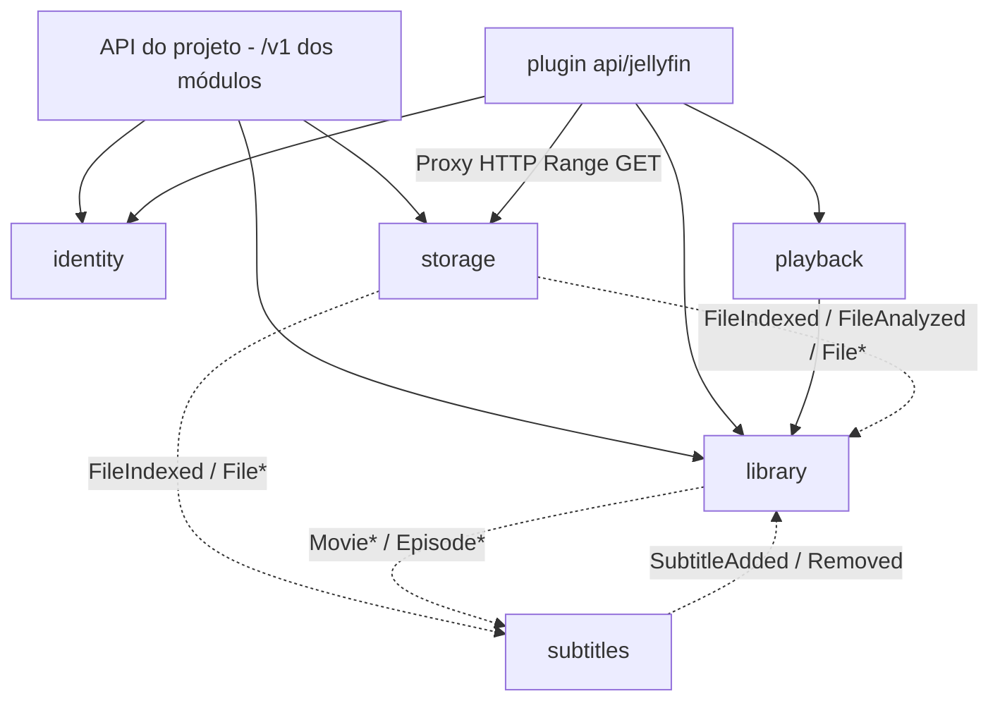

# mserver — Planejamento

Documento de resumo das decisões de arquitetura e do roadmap do projeto.
Decisões abertas estão listadas ao final e devem ser registradas aqui (ou
em ADRs em `docs/adr/`) assim que forem tomadas.

## 1. Visão geral

O **mserver** é um servidor de mídia escrito em Go que pretende substituir,
em um único projeto:

| Ferramenta | Papel no mserver                                      |
| ---------- | ----------------------------------------------------- |
| Jellyfin   | Biblioteca, streaming e transcode (prioridade máxima) |
| Sonarr     | Aquisição de séries                                   |
| Radarr     | Aquisição de filmes                                   |
| Prowlarr   | Gerenciamento de indexers                             |
| Bazarr     | Legendas                                              |
| Lingarr    | Tradução de legendas                                  |

O software pode ser executado como **monolito** (todos os módulos em um único
processo) ou, no futuro, como **microserviços** (cada módulo, ou grupo de
módulos, em uma instância diferente), a partir do mesmo binário.

## 2. Princípios

1. **Monolito modular com fronteiras rígidas.** Cada módulo é isolado
   logicamente e pode ser extraído para outra instância sem reescrita.
2. **Recursos isolados por módulo.** Cada módulo tem seu próprio banco,
   migrations, cache e filas. Não existe JOIN entre módulos; referências
   entre módulos são feitas apenas por ID.
3. **Autossuficiente.** Por padrão tudo roda localmente, sem dependências de
   infraestrutura externa (SQLite, cache em memória, fila em memória/outbox,
   disco local).
4. **Infraestrutura atrás de interfaces.** Mesmo com uma única
   implementação, a infra é acessada via interface para permitir novos
   backends no futuro. Pastas de backends ainda não implementados (ex.:
   `redis/`, `nats/`) **não** devem ser criadas antecipadamente.
5. **Compatibilidade com Jellyfin antes de UI própria, com isolamento total no plugin.**
   Os clientes oficiais do Jellyfin são a interface de reprodução; a
   administração é feita via API (curl/Bruno) até existir uma interface web.
   **Todas as regras de negócio, conceitos, DTOs, convenções e adaptações
   referentes ao Jellyfin devem estar 100% isoladas no plugin
   `plugins/api/jellyfin`.** Nenhum módulo do núcleo pode conhecer conceitos ou
   regras do Jellyfin, e **nenhum conceito não discutido deve existir fora do
   plugin do Jellyfin** — tudo o que for preciso adicionar fora de
   `plugins/api/jellyfin` deve ser discutido e aprovado antes.
6. **Processamento multimídia exclusivamente pela suíte FFmpeg.** Probe,
   transcode, geração de imagens, conversão de legendas e qualquer outro
   processamento de mídia usam os binários `ffprobe`/`ffmpeg` disponíveis
   no ambiente, executados como processos externos.
7. **Arquitetura orientada a eventos (ECST) com `Resync` universal.** Os
   módulos propagam estado de forma assíncrona via _Event-Carried State
   Transfer_ (ECST): cada módulo mantém projeções locais dos dados de que
   precisa em seu próprio banco, evitando chamadas em cascata (_fan-out_
   síncrono) no caminho crítico de leitura. Todo módulo produtor de estado
   expõe uma operação de `Resync` para republicar seu estado atual na
   outbox, garantindo consistência eventual e reconstrução de projeções.
8. **HTTP REST entre módulos desde o primeiro dia.** Toda comunicação
   síncrona entre módulos passa por HTTP REST, inclusive no monolito
   (chamadas para `http://127.0.0.1:<porta>/`). O código segue sempre o
   mesmo caminho, rodando como monolito ou como microserviços (ver seção
   4).

## 3. Decisões de arquitetura

| Tema                          | Decisão                                                                                                                                                                                                                                |
| ----------------------------- | -------------------------------------------------------------------------------------------------------------------------------------------------------------------------------------------------------------------------------------- |
| Linguagem                     | Go 1.27.3                                                                                                                                                                                                                              |
| Modo de execução              | Mesmo binário; módulos habilitados via configuração/variáveis de ambiente                                                                                                                                                              |
| Comunicação entre módulos     | **HTTP REST (JSON)** sempre; no monolito via `http://127.0.0.1:<porta>/` usando um `http.Client` central compartilhado                                                                                                                 |
| Contratos entre módulos       | Rotas e DTOs JSON definidos no pacote `router/` de cada módulo; consumidos apenas pelo pacote `client/` do próprio módulo                                                                                                              |
| Plano de dados (bytes)        | HTTP servido pelo módulo `storage` em `GET /locations/{LocationID}/files/{FileID}` (com `Range` no MVP; `PUT` no pós-MVP); bytes nunca trafegam pelos contratos JSON/eventos                                                           |
| Sincronização de estado       | **ECST (Event-Carried State Transfer)** via eventos duráveis (outbox) + operação `Resync` em todos os módulos produtores para _cold start_ e reconciliação                                                                             |
| Descoberta de serviços        | Endereços fixos definidos por variáveis de ambiente (quando houver módulos remotos)                                                                                                                                                    |
| Banco de dados                | Interface de persistência por módulo (`store.Store`); implementação inicial **SQLite**, um arquivo por módulo, migrations embutidas (`go:embed`). Outros bancos entram como novas implementações da interface                          |
| Cache                         | Em memória                                                                                                                                                                                                                             |
| Filas / eventos               | Interface em `internal/infra/queue`; implementação inicial em memória. Eventos duráveis passam pela **outbox no banco do módulo**                                                                                                      |
| Storage                       | Módulo próprio implementando um VFS; driver inicial: disco local                                                                                                                                                                       |
| Identificação de arquivos     | `FileID` opaco e ordenável (**UUIDv7**), gerado pelo `storage` na indexação; `ffprobe` roda como analisador do `storage` no MVP e hashes entram no pós-MVP (seção 7)                                                                   |
| API do projeto                | As próprias APIs REST dos módulos, servidas juntas em `/v1` (sem surface intermediária)                                                                                                                                                |
| Processamento multimídia      | `ffprobe` (analisador no `storage` no MVP) e `ffmpeg` (no `transcoder` no pós-MVP, com controle de processo via `SIGSTOP`/`SIGCONT`/`SIGTERM`) disponíveis no ambiente, via `exec`. Reavaliar (ex.: build próprio) se houver problemas |
| FFmpeg ausente                | Módulos que dependem dele (`storage` com `ffprobe` no MVP; `transcoder` com `ffmpeg` no pós-MVP) não inicializam; no monolito, o servidor falha no startup                                                                             |
| Integrações de infra externas | Nenhuma por enquanto (sem Redis, NATS, Postgres etc.)                                                                                                                                                                                  |
| Clientes de download          | **Não** haverá cliente embutido; apenas integração com clientes externos (Transmission, qBittorrent, SABnzbd) via plugins                                                                                                              |
| Plugins                       | Inicialmente apenas internos (compilados no binário); suporte a plugins externos no futuro                                                                                                                                             |
| Metadados                     | **Fora do MVP.** O MVP implementa apenas o fallback baseado em nomes de arquivos (seção 8)                                                                                                                                             |
| Compatibilidade Jellyfin      | Alvo: API do **Jellyfin 12.4.0** (`docs/jellyfin-openapi-stable.json`); cliente alvo do MVP: **`jellyfin-web`** (`jellyfin-android` e `jellyfin-tizen` no pós-MVP)                                                                     |
| Licença                       | Apache 2.0                                                                                                                                                                                                                             |

## 4. Comunicação entre módulos

### 4.1 Estratégia

- Cada módulo funciona como uma **mini aplicação HTTP**: registra suas
  rotas REST **na raiz**, versionadas e agrupadas por contexto (ex.:
  `/v1/sessions`, `/v1/accounts/{id}`, `/v1/locations`), sem prefixo do
  módulo, e entrega um `*http.ServeMux` ao `cmd/server`. Todos os módulos
  compartilham o mesmo `/v1`: cada contexto (recurso) pertence a um único
  módulo, então as rotas não colidem.
- No monolito, o `cmd/server` encaminha cada requisição ao primeiro mux de
  módulo que tiver uma rota compatível (ou `404`). APIs e plugins são
  montados em caminhos próprios (via `http.StripPrefix`):

  | Montagem             | Conteúdo                  | Exemplo                         |
  | -------------------- | ------------------------- | ------------------------------- |
  | `/`                  | APIs de todos os módulos  | `/v1/sessions`, `/v1/locations` |
  | `/plugins/<plugin>/` | Plugins de API (surfaces) | `/plugins/jellyfin/Users/Me`    |

- **Autenticação das rotas de módulos:** por simplicidade, as rotas dos
  módulos (`/v1`) não têm autenticação no momento; a segurança delas será
  definida no futuro. Até lá, elas não devem ficar expostas fora de uma
  rede confiável. Os plugins de API têm autenticação própria.
- **Exposição:** o servidor tem um único listener e sempre roda atrás de
  um API gateway/reverse proxy, que filtra o que fica exposto ao exterior
  (ex.: apenas `/plugins/<plugin>/`). Listeners separados para rotas
  públicas e internas ficam para quando houver necessidade.

- Todas as rotas de módulos são versionadas (`/v1`).
  Plugins de API seguem os caminhos do protocolo que implementam (o
  Jellyfin não tem versão no path); o cliente Jellyfin é configurado com
  o endereço `http://<host>:<porta>/plugins/jellyfin`.
- Outros módulos e plugins **nunca** importam o `service` de outro módulo;
  eles usam o pacote `client/` do módulo de destino, que faz chamadas HTTP.
- No monolito, o `cmd/server` sobe um único listener, monta os muxes de
  todos os módulos nele e aponta os clients para
  `http://127.0.0.1:<porta>`. Distribuído, cada módulo roda em seu
  próprio binário e os clients apontam para o endereço remoto. **O código
  dos consumidores é o mesmo nos dois cenários.**
- Não existe gerência de dependências entre módulos na inicialização: um
  client é só um endereço; se o módulo de destino estiver indisponível, a
  chamada falha em tempo de execução como falharia em microserviços.

### 4.2 Regras dos contratos HTTP

Toda rota entre módulos (e as usadas por plugins) deve seguir:

1. **Assinatura padrão no client:** `ctx context.Context` como primeiro
   parâmetro e `error` como último retorno em todos os métodos.
2. **Apenas tipos serializáveis em JSON** nos DTOs: tipos primitivos,
   structs, slices, maps com chave `string`, `time.Time` e UUIDs.
   **Proibido:** `func`, `chan`, `io.Reader`/`io.Writer`, `*sql.DB`,
   interfaces dentro de DTOs ou qualquer handle de recurso.
3. **DTOs pertencem ao `router/`** do módulo e são reutilizados pelo seu
   `client/`; structs planas e explícitas, campos opcionais explícitos.
   Como mudam junto com a versão da API, todo DTO leva a versão como
   sufixo (ex.: `AccountV1`, `SetupRequestV1`, `ErrorV1`).
   **Eventos também são API:** seus tipos e payloads ficam no pacote
   `events/` do módulo emissor, seguindo as mesmas regras (ex.: o tipo
   `FileIndexedV1 = "storage.file.indexed.v1"` e o payload
   `FileEventV1`).
4. **Erros tipados:** respostas de erro usam o corpo `{"error": "..."}` e
   status HTTP mapeados a partir dos erros do service (`400`
   InvalidArgument, `401` Unauthenticated, `403` PermissionDenied, `404`
   NotFound, `409` AlreadyExists, `412` FailedPrecondition, `503`
   Unavailable, `500` Internal). O client converte o status de volta para
   os erros sentinela do módulo, e os consumidores usam
   `errors.Is`/`errors.As`, nunca comparação de strings.
5. **Coleções grandes paginadas** (cursor/limite), nunca listas
   ilimitadas.
6. **Bytes e paths físicos fora dos contratos JSON:** arquivos são
   referenciados pelo `FileID` (seção 7) e acessados via HTTP do `storage`
   (ou por caminho local quando `Resolve` permitir). Caminhos só aparecem
   como **dados relativos a uma localização**.
7. **Eventos versionados e idempotentes:** eventos usam o envelope
   CloudEvents (seção 4.3) com ID, timestamp e tipo versionado;
   consumidores devem tolerar entrega duplicada (at-least-once).
8. **Sem estado global compartilhado** entre módulos; cada módulo acessa
   apenas seu próprio banco e recursos.
9. **Wiring centralizado:** apenas `cmd/server` cria o `http.Client`
   central e os clients de todos os módulos.
10. **Testes de contrato:** cada `client/` é testado contra o `router/` real
    do módulo (via `httptest`), garantindo que ida e volta pelo HTTP
    preservam dados e erros.

### 4.3 Filas, eventos e outbox

- **Efêmero** (pode ser perdido em um restart sem prejuízo, ex.:
  notificações internas de progresso): publicado direto no barramento em
  memória.
- **Durável** (não pode ser perdido, ex.: scan de biblioteca, geração de
  imagens, transcode pendente, eventos entre módulos que alteram estado):
  **padrão outbox** no banco do próprio módulo.
  - O registro do job/evento é gravado **na mesma transação** da alteração
    de estado que o originou. Quem coordena isso é o **service**: ele abre
    a transação pelo `store` (`WithTx`), aplica a alteração pelo `store` e
    publica pelo outbox.
  - Um relay verifica a outbox periodicamente (a cada 1s), lê os eventos
    em ordem, publica cada um e o apaga em seguida. Em caso de falha,
    para no evento que falhou e tenta de novo na próxima rodada, mantendo
    a ordem.
  - Como a entrega é at-least-once, os consumidores devem ser idempotentes
    (seção 4.2, regra 9), usando o ID do evento para descartar
    duplicados.
- **Pacote `internal/infra/outbox`:** tudo o que é da outbox fica
  isolado nele, reutilizável por qualquer módulo.
  - `outbox.New(ctx, db, publisher, log)` recebe o banco do módulo e cria
    a própria tabela (`outbox`), sem passar pelas migrations do módulo.
  - `Publish(ctx, events...)` recebe um ou vários eventos (`queue.Event`,
    implementado por `queue.Envelope[T]`) e os grava em JSON na transação
    aberta no `ctx`. Se ela sofrer rollback, os eventos são descartados.
    Sem transação no `ctx`, o lote é gravado em uma transação própria.
  - A chave da tabela é o **ID do evento** (UUIDv7), que também define a
    ordem de publicação. Não há `AUTOINCREMENT`: o ID é portável entre
    bancos e é o mesmo usado pelos consumidores para deduplicação. A ordem
    é garantida dentro do processo, porque o gerador de UUIDv7 é monótono.
  - `Start`/`Stop` controlam o relay.
  - A atomicidade depende de a outbox e o `store` usarem o **mesmo**
    `*sql.DB`; quem garante isso é o `module.go`, que abre o banco e o
    entrega aos dois.
  - Hoje o SQL do pacote segue o dialeto do SQLite. Quando outro banco
    entrar, o outbox ganha uma implementação para ele.
- **Separação de camadas:**
  - O `store` lida **apenas com o banco**: não conhece eventos nem o
    outbox.
  - O **service** concentra a regra de negócio: monta os eventos e
    publica pelo outbox.
  - O `module.go` faz o wiring e o ciclo de vida: abre o banco, cria o
    outbox e o `store` sobre ele e inicia o relay no `New` (parado no
    `Close`).
- **Transação no contexto:** `internal/infra/database` tem `WithTx(ctx,
db, fn)` e `ConnFrom(ctx, db)`. A transação aberta viaja no `ctx`, e
  toda consulta feita com esse `ctx` no mesmo banco entra nela (store e
  outbox). Chamadas aninhadas reaproveitam a transação aberta. O
  `store.WithTx` expõe isso ao service sem vazar `database/sql`.
- **Barramento:** `internal/infra/queue` define `Publisher`/`Subscriber`
  com mensagens `{Topic, Payload}`. A implementação
  inicial (`queue/memory`) chama os handlers do tópico de forma síncrona;
  se algum falhar, o evento permanece na outbox e é reentregue a todos.
  NATS/RabbitMQ entram no futuro como novas implementações.
- **Envelope:** todo evento é publicado no formato JSON estruturado do
  **CloudEvents 1.0**, definido manualmente em `queue.Envelope[T]` (sem o
  SDK, que traz dependências e camadas de transporte desnecessárias
  aqui).

  | Campo         | Conteúdo                                                           |
  | ------------- | ------------------------------------------------------------------ |
  | `id`          | UUIDv7, usado pelos consumidores para descartar duplicados         |
  | `type`        | Nome versionado, ex.: `storage.file.indexed.v1`; é também o tópico |
  | `source`      | Módulo de origem, ex.: `storage`                                   |
  | `specversion` | `1.0`                                                              |
  | `time`        | Momento do evento (UTC)                                            |
  | `subject`     | Recurso principal, ex.: o `FileID`                                 |
  | `data`        | Payload específico, definido no `events/` do módulo de origem      |

  Consumidores decodificam `queue.Envelope[<events do módulo>.<Evento>V<n>]`
  (ex.: `queue.Envelope[storageevents.FileEventV1]`), importando o pacote
  `events/` do módulo emissor.

### 4.4 ECST (Event-Carried State Transfer) e `Resync`

Para atingir baixa latência de leitura (estilo Netflix) mesmo com bancos
isolados por módulo, a comunicação entre módulos prioriza **eventos
carregando estado (ECST)** em vez de chamadas síncronas em cascata:

- **Projeções locais (padrão obrigatório):** cada módulo escuta os eventos dos
  módulos dos quais depende e mantém uma projeção local enxuta no seu próprio
  banco SQLite, evitando consultas síncronas entre módulos. Métodos de consulta
  síncrona que deixarem de ser necessários por conta das projeções locais (ex.:
  `ListSiblings` ou `ListFiles` no contrato do `storage`) serão removidos na
  implementação. Por exemplo, a `library` consolida o catálogo completo (itens,
  streams do `ffprobe`, capítulos, segmentos, legendas e metadados) reagindo a
  eventos; o `subtitles` mantém sua projeção local de arquivos e itens da
  `library` para fazer o match bidirecional; e o `watchstate` mantém uma
  projeção da topologia do catálogo (`Series → Season → Episode`) para calcular
  próximos episódios, itens em andamento e contadores localmente em `O(1)`.
- **Escrita de arquivos sempre síncrona (Push no `storage`):** apenas o
  `storage` manipula dados físicos. Qualquer módulo que produza um arquivo
  (`transcoder`, `subtitles`, `metadata`, `downloader`) grava-o de forma
  síncrona no `storage` (via contrato/HTTP `PUT`), e o `storage` emite os
  eventos correspondentes (`FileIndexed`, `FileAnalyzed`). O `storage`
  nunca busca dados nos outros módulos.
- **RPC síncrono restrito ao estritamente necessário:** chamadas síncronas
  entre módulos ocorrem apenas quando há interação imediata bloqueante
  (ex.: `playback` chamando `StartTranscode` no `transcoder` ao iniciar um
  stream HLS, ou módulos gravando arquivos no `storage`).
- **Operação `Resync` universal:** todo módulo produtor de estado implementa
  uma operação de `Resync` por contexto, exposta como rota REST (ex.:
  `POST /v1/accounts/resync` e `POST /v1/profiles/resync` no `identity`).
  Ao ser
  invocada, ela lê os registros atuais do banco do módulo e republica os
  eventos de estado na outbox. Como todo consumidor é idempotente (upsert
  por ID), o `Resync` resolve:
  1. **Cold start:** quando uma nova biblioteca é cadastrada ou um módulo
     opcional (ex.: `metadata`, `subtitles`) é habilitado depois que o
     sistema já possui dados.
  2. **Reconstrução e autocura:** se o banco de um módulo derivado for
     recriado ou ficar inconsistente, basta acionar o `Resync` dos módulos
     produtores para reconstruir o estado sem perda.

> O detalhamento completo do contexto de cada módulo e o catálogo de todos
> os eventos e seus payloads estão em
> [`docs/modulos-e-eventos.md`](modulos-e-eventos.md).

## 5. Plugins vs. backends

Critério: **quem escolhe e quantos ficam ativos ao mesmo tempo?**

| Critério           | Backend                                   | Plugin                                        |
| ------------------ | ----------------------------------------- | --------------------------------------------- |
| Quem escolhe       | Operador, na instalação/deploy            | Usuário, em tempo de execução                 |
| Quantos ativos     | Normalmente um                            | Vários simultaneamente, com prioridade/ordem  |
| Configuração       | Arquivo de config / variáveis de ambiente | API (credenciais, prioridade, por biblioteca) |
| Conjunto de opções | Fechado e estável                         | Aberto (terceiros podem querer criar novos)   |
| Semântica          | Idêntica entre implementações             | Cada um traz dados/comportamentos diferentes  |
| Onde fica          | `internal/infra/` ou dentro do módulo     | `plugins/<módulo>/<nome>`                     |

Regra prática: **se um terceiro iria querer escrever, é plugin; se só o
operador escolhe, é backend.**

### 5.1 Classificação

- **Backends:** SQLite, cache em memória, filas (memória/outbox), drivers
  do VFS (disco local; S3 no futuro — ficam dentro do módulo `storage`).
- **Plugins:** analisadores de arquivos do `storage` (`ffprobe`, SHA-256,
  ED2K), provedores de metadados e segmentos (TVDB, TMDB, AniDB, AniSkip,
  IntroDB — pós-MVP), sincronizadores de estado no `watchstate` (Trakt,
  AniList — pós-MVP), indexers (Torznab, Newznab, Cardigann), clientes de
  download (qBittorrent, Transmission, SABnzbd), provedores de legenda,
  motores de tradução, notificações e a API de compatibilidade Jellyfin.

### 5.2 Tipos de plugin

1. **Provider** — fornece dados/capacidades a um módulo (analisadores de
   arquivos, metadados, indexer, download client, legendas, tradução).
2. **Surface** — expõe o sistema para fora, consumindo vários módulos
   (ex.: `api/jellyfin`).
3. **Hook** — reage a eventos (notificações, webhooks).

> A **API do projeto** não é um plugin: ela é formada pelas próprias
> APIs REST dos módulos, sempre presentes (ver seção 6.1).

### 5.3 Diretrizes

- Plugins podem ser **bundled** e habilitados por padrão.
- Plugins internos usam **apenas o contrato público** do módulo que
  estendem. Se precisarem de algo interno, o contrato está incompleto.
- Contratos de plugin seguem as mesmas regras da seção 4.2, permitindo
  plugins externos no futuro.
- Registro explícito (`plugins/all.go`), sem depender de `init()`.
- Cada módulo extensível possui um registro baseado em um `Registry[T]`
  genérico.

## 6. Módulos

| Módulo         | Substitui                      | Responsabilidade                                                                                                                                     | Fase    |
| -------------- | ------------------------------ | ---------------------------------------------------------------------------------------------------------------------------------------------------- | ------- |
| `storage`      | —                              | VFS, localizações, indexação e `FileID`, analisadores (`ffprobe` no MVP; hashes no pós-MVP), API HTTP de dados (`Range`), eventos, `Resync`          | MVP     |
| `identity`     | —                              | Contas (`Account`: email, username, senha), perfis (`Profile`: handle, nome), dispositivos, sessões e tokens                                         | MVP     |
| `library`      | Jellyfin (catálogo)            | Catálogo materializado global (100% cacheável): bibliotecas, identificação por path via eventos (filmes e séries), informações técnicas e legendas   | MVP     |
| `playback`     | Jellyfin (playback)            | Sessões de reprodução ativas, decisão de reprodução (Direct Play no MVP) e eventos de playback (salas compartilhadas no pós-MVP)                     | MVP     |
| `subtitles`    | Bazarr                         | MVP: match bidirecional de legendas locais `.srt` via projeção própria alimentada por eventos. Pós-MVP: outros formatos e provedores externos        | MVP     |
| `watchstate`   | Jellyfin (`UserData`)/Tautulli | Estado e histórico por **perfil** (`ProfileID`): progresso, assistidos, favoritos, próximos episódios e _watch history_                              | Pós-MVP |
| `transcoder`   | Jellyfin (transcode)           | Workers `ffmpeg`: HLS em tempo real (controlado por `SIGSTOP`/`SIGCONT`) e jobs em background (conversão de legendas, thumbnails, capítulos, intros) | Pós-MVP |
| `metadata`     | Jellyfin (providers)           | Provedores externos de metadados, artes e segmentos de abertura/encerramento (plugins: TVDB, TMDB, AniDB, AniSkip, IntroDB, ...)                     | Pós-MVP |
| `indexer`      | Prowlarr                       | Indexers e busca assíncrona de releases (plugins: Torznab, Newznab, Cardigann)                                                                       | Pós-MVP |
| `downloader`   | (parte dos \*arr)              | Integração com clientes de download externos (plugins) e escrita/hardlink dos arquivos concluídos no `storage`                                       | Pós-MVP |
| `acquisition`  | Sonarr + Radarr                | Monitoramento do catálogo, perfis de qualidade, motor de decisão e coordenação assíncrona com `indexer` e `downloader`                               | Pós-MVP |
| `translation`  | Lingarr                        | Tradução assíncrona de legendas (plugins)                                                                                                            | Pós-MVP |
| `notification` | —                              | Notificações e webhooks (plugins) reagindo aos eventos de todos os módulos                                                                           | Pós-MVP |

Observações:

- **Contas (`Account`) vs. Perfis (`Profile`) e Migração de Perfil (`identity` + `watchstate`):**
  - O `identity` separa **Conta (`AccountID`)** de **Perfil (`ProfileID`)** desde o dia 1, no modelo da Netflix:
    - **Conta (`Account`):** guarda credenciais e dados administrativos (`username`, `email`, senha, flag `is_admin` e, no futuro, vínculo SSO OIDC).
    - **Perfil (`Profile`):** pertence a uma conta e guarda os dados de apresentação e consumo (nome, identificador/handle curto e, no futuro, imagem/avatar). Uma conta pode ter vários perfis.
  - Todas as sessões no `playback` (e, no pós-MVP, todo o histórico e estado no `watchstate`) são vinculadas exclusivamente ao **`ProfileID`**, nunca ao `AccountID`.
  - **Migração de perfil entre contas em `O(1)` (Pós-MVP):** como o `watchstate` indexa tudo por `ProfileID`, transferir um perfil de uma conta para outra exige apenas atualizar o `account_id` do perfil no `identity` (emitindo `ProfileTransferred`), levando todo o histórico e favoritos automaticamente sem alterar nenhuma linha no banco do `watchstate`.
- **Separação entre Catálogo (`library`), Sessão de Reprodução (`playback`) e Estado do Perfil (`watchstate` — Pós-MVP):**
  - A `library` não conhece contas, perfis nem conceitos do Jellyfin: seu banco e seu cache são 100% globais e alimentados de forma reativa pelos eventos do `storage` e `subtitles` (e, no pós-MVP, `transcoder` e `metadata`).
  - O `playback` gerencia a decisão de reprodução e o estado efêmero das sessões ativas, emitindo eventos de sessão (`PlaybackStarted`, `PlaybackProgressed`, `PlaybackPaused`, `PlaybackResumed`, `PlaybackStopped`).
  - No MVP, como o módulo `watchstate` fica para o segundo momento, o plugin `plugins/api/jellyfin` devolve `UserData` com valores padrão zerados e listas vazias para `Resume` e `NextUp`. Quando o `watchstate` entrar no pós-MVP, ele passará a consumir os eventos da `library` e do `playback` sem alterar esses módulos.
- **Salas de reprodução compartilhada (Pós-MVP):**
  - Entrarão no módulo `playback` no pós-MVP suportando código de acesso. Qualquer adaptação para o protocolo `SyncPlay` do Jellyfin fica isolada em `plugins/api/jellyfin`.
- **Controle eficiente do `transcoder` (`SIGSTOP`/`SIGCONT` — Pós-MVP):**
  - Entrará no pós-MVP para transcode de áudio HLS (`-c:v copy`), conversão de legendas (`.srt`/`.ass` → `.vtt`) e extração de imagens/segmentos em background.
- **Capítulos (`Chapters`) e Pular Abertura/Créditos (`MediaSegments` — Pós-MVP):**
  - Ficam fora do MVP e entrarão no segundo momento (extraídos via `ffprobe`, provedores externos no `metadata` e detecção automática no `transcoder`).
- Sonarr e Radarr serão unificados em `acquisition`, com "tipos de mídia",
  pois compartilham parser de releases, perfis de qualidade e motor de
  decisão, comunicando-se por eventos com `indexer` e `downloader`.
- O wrapper de baixo nível do `ffprobe` (e futuramente `ffmpeg`) fica em
  `internal/infra/ffmpeg` e é usado pelo analisador `ffprobe` do `storage`.
  Ele recebe caminhos/URLs já resolvidos pelo `storage`.
- **Dependências obrigatórias:** cada módulo valida, no `New`, as
  dependências externas de que precisa (no MVP, o `storage` valida `ffprobe`).
  Se a validação falhar, o módulo não inicializa e o startup do processo é
  abortado com uma mensagem de erro clara.
- Quando o módulo `metadata` existir, a identificação por nome de arquivo
  (seção 8) continua na `library` como identificação inicial e **fallback**
  para itens sem metadados externos encontrados.

### 6.1 Surfaces: API do projeto e API Jellyfin

- **Regra inegociável de isolamento:**
  - **Todas as regras de negócio, modelos de dados, rotas e adaptações referentes ao Jellyfin devem estar estritamente isoladas dentro do plugin `plugins/api/jellyfin`.**
  - **Nenhum conceito que não tenha sido discutido deve existir fora de `plugins/api/jellyfin`.** Tudo o que for preciso adicionar fora do plugin do Jellyfin (nos módulos de domínio, em suas APIs REST ou na infraestrutura) **deve ser discutido antes**.
- A **API do projeto** é o conjunto das APIs REST dos módulos, servidas
  juntas em `/v1` (ex.: `POST /v1/setup` do `identity`, `/v1/locations` do
  `storage`), ainda sem autenticação. Não existe uma surface intermediária: a administração do
  servidor (contas, perfis, localizações, bibliotecas e operações
  administrativas) usa diretamente as rotas dos módulos. Novas rotas
  devem ser discutidas antes da implementação.
- O **plugin `api/jellyfin`** (`plugins/api/jellyfin`) concentra **100% das
  rotas e regras de compatibilidade com a API do Jellyfin 12.4.0** (descoberta,
  login, parse de `<username ou email>#<profile>`, `QuickConnect`, tradução de
  catálogo para `BaseItemDto`/`MediaSources`/`MediaStreams`/`DeliveryUrl`,
  avaliação de `DeviceProfile` em `PlaybackInfo`, conversão de unidades para
  `Ticks`, sessões de reprodução e streaming). Nenhuma rota ou regra do
  Jellyfin existe nos módulos.
- **Streaming de vídeo e legendas via Proxy no plugin Jellyfin:** o módulo
  `storage` expõe apenas sua rota HTTP interna de dados
  (`GET /locations/{LocationID}/files/{FileID}`, com suporte a `Range`). Nas
  rotas de streaming do Jellyfin (`GET /Videos/{itemId}/stream*` e
  `GET /Videos/.../Subtitles/.../Stream.srt`), o plugin `api/jellyfin` atua
  como **proxy reverso em streaming** para o `storage` (repassando `Range`,
  `Content-Range`, `Content-Length` e status `200`/`206`).
- Surfaces apenas traduzem protocolo e compõem DTOs (rotas, autenticação,
  códigos de erro). Se duas surfaces precisarem da mesma regra de negócio do
  domínio do `mserver`, ela deve ser discutida antes de entrar no contrato de
  um módulo.
- No modo distribuído, surfaces são "módulos sem banco" que podem rodar
  em qualquer instância, falando com os demais módulos via HTTP REST.



## 7. Módulo de storage (VFS)

Todo acesso a dados de mídia passa pelo módulo `storage`.

**Apenas o `storage` lida com paths físicos.** Depois que um arquivo é
indexado, o restante do projeto o referencia pelo **`FileID`**. Quando
outros módulos precisam de nomes de pastas/arquivos, recebem **caminhos
relativos à localização** (ex.: à pasta da biblioteca), nunca caminhos
absolutos.

### 7.1 Conceitos

- **Localização (`Location`):** único conceito de "onde ficam os
  arquivos". É um diretório acessado por um **driver** (ex.: driver
  `local` em `/mnt/hdd/series`), identificado por um `LocationID`. Não
  existe um agrupamento acima dela (não há "storages nomeados").
  **Diretórios são responsabilidade exclusiva do `storage`:** são
  cadastrados nele (via API do projeto, informando driver e opções do
  driver, como o diretório), e os demais módulos apenas
  referenciam o `LocationID`. O storage indexa e observa apenas
  localizações conhecidas (cadastradas ou de sistema, ver abaixo).
  **Localizações não podem se sobrepor:** cadastrar um diretório que
  está dentro de outra localização, ou que contém outra, é recusado.
  Assim, todo arquivo pertence a exatamente uma localização.
- **Classe da localização (planejado, entra no pós-MVP com o `transcoder`):**
  no MVP só existem localizações cadastradas pelo operador (`media`). Classes e
  localizações de sistema serão implementadas quando houver um módulo
  que grave artefatos. A classe define como o storage trata os arquivos
  dela. **Todo arquivo, de qualquer classe, é indexado e tem `FileID`.**
  O que muda entre as classes é o fluxo aplicado depois da indexação.

| Classe       | Criada por                            | Analisadores (seção 7.3) | TTL | Uso                                                   |
| ------------ | ------------------------------------- | ------------------------ | --- | ----------------------------------------------------- |
| `media`      | Operador, via API do projeto          | Sim (`ffprobe` no MVP)   | Não | Diretórios de bibliotecas (mídia e legendas externas) |
| `cache`      | Storage, automaticamente (de sistema) | Não                      | Sim | Artefatos temporários (ex.: legendas convertidas)     |
| `transcodes` | Storage, automaticamente (de sistema) | Não                      | Sim | Segmentos e playlists HLS gerados pelo `ffmpeg`       |
| `images`     | Storage, automaticamente (de sistema) | Não                      | Sim | Imagens, frames de capítulos e _trickplay_ (pós-MVP)  |

- **Localizações de sistema** (todas as classes exceto `media`):
  - São criadas pelo storage no `New`. O driver e o destino de cada uma
    são definidos pelo operador via variáveis de ambiente no formato
    `MSERVER_STORAGE_DRIVER_<DRIVER>_<LOCALIZAÇÃO>_<OPÇÃO>` (ex.:
    `MSERVER_STORAGE_DRIVER_LOCAL_CACHE_DIR=/mnt/ssd/cache`). Sem
    configuração, usam o driver local em `<MSERVER_DATA_DIR>/<classe>`.
    Configurar mais de um driver para a mesma localização é erro no
    `New`.
  - Não podem ser usadas como diretório de biblioteca.
  - Os arquivos são gravados pelos módulos via contrato do storage, que
    devolve o `FileID`.
  - **TTL:** como em uma CDN, cada arquivo pode ter um tempo de vida,
    definido na escrita (com um padrão configurável por classe, ex.:
    `MSERVER_STORAGE_CACHE_TTL`). Assim, os módulos não precisam
    gerenciar a remoção dos artefatos.
    - O TTL pode ser **renovado** (ex.: segmentos HLS de uma sessão de
      playback ainda ativa).
    - Um arquivo expirado deixa de ser acessível imediatamente
      (`NotFound`), mesmo antes da remoção física.
    - A expiração fica gravada no índice; uma rotina do storage remove
      os expirados (índice e driver) e emite `FileRemoved`.
    - Arquivos sem TTL persistem até serem apagados explicitamente (por
      `FileID`).
    - Quando o driver for uma CDN/object storage com expiração nativa,
      o TTL poderá ser repassado a ele.
  - **Motivação:** como todo artefato tem `FileID` e é acessado via
    `Resolve`, mover cache, imagens ou transcodes para uma CDN ou um
    storage distribuído no futuro não muda os demais módulos.
- **`FileID`:** identificador opaco e ordenável por tempo (**UUIDv7**),
  gerado na primeira indexação. UUIDv7 foi escolhido em vez de ULID por
  ser um UUID padrão: compatível com os GUIDs do Jellyfin, com tipos `uuid`
  de bancos e com as libs de UUID do Go, mantendo a ordenação temporal.
- **Estabilidade do `FileID`:**
  - **Mudança de conteúdo** no mesmo caminho (tamanho/mtime/inode
    diferentes): mantém o `FileID` e emite `FileChanged`.
  - **Movido/renomeado** dentro da mesma localização: um caminho novo com
    o `inode` de um arquivo que sumiu é o mesmo arquivo; mantém o
    `FileID` e emite `FileMoved`. Sem suporte a inode no driver, o
    arquivo é tratado como removido + adicionado (novo `FileID`).
  - **Movido entre localizações ou sistemas de arquivos (pós-MVP):**
    reconhecido depois da análise, pelo SHA-256 de um arquivo que acabou
    de sumir.
- **Hardlinks e cópias** são caminhos físicos diferentes e, portanto,
  `FileID`s diferentes; o SHA-256 permite identificá-los como conteúdo
  idêntico.

### 7.2 Indexação

A indexação acontece em duas etapas, para que um arquivo apareça no
sistema sem esperar a leitura ou inspeção completa do conteúdo:

1. **Registro (rápido):** varredura da localização; grava `FileID`,
   localização, caminho relativo, tamanho, mtime e `inode` (quando
   suportado). Emite `FileIndexed`.
2. **Análise:** executa os analisadores habilitados (seção 7.3) de forma
   assíncrona — no MVP, o analisador `ffprobe` para arquivos de mídia; no
   pós-MVP, também os analisadores de hash — e emite `FileAnalyzed`.

Regras:

- **Quando varrer:** todas as localizações são varridas ao iniciar o
  módulo e periodicamente (`MSERVER_STORAGE_SCAN_INTERVAL`). O `storage`
  também expõe `Resync(ctx, LocationID)` para republicar os eventos
  `FileIndexed` e `FileAnalyzed` de todos os arquivos já conhecidos de uma
  localização (ex.: chamado quando a `library` cadastra uma nova
  biblioteca sobre uma localização já indexada). Observação em tempo real
  (`fsnotify`) fica para depois do MVP.
- Arquivos em escrita (cópia ou download em andamento) só serão
  analisados quando o `mtime` for mais antigo que uma janela de
  estabilidade; os mais recentes ficam para a próxima passada.
- **Escrita síncrona por outros módulos (Push):** toda criação de arquivo
  por qualquer módulo (`transcoder`, `subtitles`, `metadata`,
  `downloader`) é feita de forma síncrona no `storage` (via contrato/HTTP
  `PUT`). O `storage` nunca puxa arquivos de outros módulos. Nas
  localizações de sistema, o registro acontece no momento da escrita e o
  `FileID` é devolvido imediatamente; nas localizações `media`, a escrita
  também registra o arquivo e dispara o pipeline normal de eventos
  (`FileIndexed` → `FileAnalyzed`).
- Se a raiz de uma localização, ou qualquer diretório dela, ficar
  inacessível (ex.: disco desmontado), a varredura **falha sem alterar o
  índice** e não gera `FileRemoved` em massa. Isso evita apagar itens e
  dados derivados por uma falha temporária.

### 7.3 Analisadores de arquivos (plugins)

- Informações técnicas de mídia e hashes são
  calculados por **analisadores**, plugins do tipo provider do `storage`
  (`plugins/storage/<nome>`).
- **O próprio módulo inicializa seus plugins** (no `New`, a partir das
  suas variáveis de ambiente), com a interface que fizer sentido para ele
  (aqui, `storage/analyzer.Analyzer`). Só os plugins de API
  (`plugins/api/*`) são criados fora dos módulos, pelo `cmd/server`,
  porque se integram diretamente ao servidor HTTP.
- **MVP:** analisador `ffprobe` (`plugins/storage/ffprobe`), que inspeciona
  arquivos de mídia e extrai container, duração, bitrate e faixas de vídeo,
  áudio e legendas embutidas (`MediaStreams`).
- **Pós-MVP:** extração de capítulos embutidos (`Chapters`) no `ffprobe` e
  analisadores de hash (`sha256`, `ed2k` e, futuramente, hash do OpenSubtitles,
  BLAKE3).
- **Leitura única para hashes:** para analisadores baseados em stream de
  bytes, o storage lê o arquivo **uma única vez** e alimenta todos em
  paralelo, em vez de ler um arquivo de 50 GB uma vez por algoritmo.
- Cada resultado é gravado como `(FileID, analisador, versão, valor)` e
  publicado via `FileAnalyzed`. Mudar a versão de um analisador dispara a
  reanálise dos arquivos.
- Os analisadores rodam apenas sobre arquivos de localizações da classe
  `media`. Arquivos de localizações de sistema (`cache`, `transcodes`,
  `images`) são indexados, mas não passam pelos analisadores.
- Exceção às regras da seção 4.2: o contrato de analisador recebe os
  bytes em blocos (streaming) ou o caminho/URL resolvido (no caso do
  `ffprobe`), pois existe apenas dentro do processo do `storage`.

### 7.4 Metadados de um arquivo

| Campo                             | Origem                         |
| --------------------------------- | ------------------------------ |
| `FileID` (UUIDv7)                 | Storage, na primeira indexação |
| `LocationID`                      | Localização cadastrada         |
| Caminho relativo                  | Relativo à localização         |
| Tamanho, mtime                    | Driver                         |
| `inode`                           | Driver (quando suportado)      |
| Container, duração, streams, caps | Analisador `ffprobe` (MVP)     |
| SHA-256, ED2K, ...                | Analisadores de hash (pós-MVP) |
| Indexado em                       | Storage                        |

### 7.5 Acesso aos dados

- **Leitura de nomes ≠ acesso:** a `library` e o `subtitles` usam o
  caminho relativo recebido nos eventos `FileIndexed`/`FileMoved` para
  aplicar regex e fazer o match, mas nenhum módulo usa caminhos para
  acessar, mover ou apagar arquivos: toda operação recebe `FileID`.
- **Legendas externas são arquivos como quaisquer outros:** são
  indexadas pelo `storage` e geram `FileIndexed`. O módulo `subtitles`
  escuta esses eventos, faz o match com os itens da `library` e emite
  `SubtitleAdded` contendo o `FileID`. O `playback`/`transcoder` acessam a
  legenda via `Resolve`, como fazem com a mídia.
- **Escrita síncrona por outros módulos:** qualquer módulo que crie
  arquivos informa `LocationID` + caminho relativo (ou classe de sistema)
  e envia os dados de forma síncrona ao `storage`.
- **Artefatos gerados:** legendas convertidas, segmentos HLS e, no futuro,
  imagens, frames de capítulos e _trickplay_ são gravados de forma síncrona
  no `storage` nas localizações de sistema (`cache`, `transcodes`,
  `images`), e não ao lado da mídia. Cada artefato recebe um `FileID`.
- **API HTTP de dados (`storage`):**
  - Expõe `GET /locations/{LocationID}/files/{FileID}` (e `HEAD`) com suporte a
    `Range` (`206 Partial Content`, `Accept-Ranges: bytes`, `Content-Length`,
    `Content-Type`). Implementada na Entrega 4 (`playback`). O `storage` não
    expõe nenhuma rota do Jellyfin; o plugin `api/jellyfin` faz proxy em
    streaming para essa rota.
  - Escrita via `PUT` (saída do `ffmpeg`, legendas convertidas, imagens) e
    autenticação por URLs assinadas de curta duração entram no pós-MVP com o
    `transcoder`.
- **Resolução por consumidor:** `Resolve(FileID, consumer) → URL`.
  - Consumidor local e driver local → caminho direto no disco (sem
    overhead).
  - Consumidor remoto → URL HTTP assinada.
  - Isso permite executar transcodes em máquinas externas sem levar os
    discos/dados até elas.

### 7.6 Drivers e capacidades

- **Drivers:** disco local (`driver/local`) no início; S3 e outros no
  futuro. Cada localização fica confinada ao seu diretório (ex.:
  `os.Root` no driver local), sem permitir path traversal.
- **Capacidades por driver (planejado):** quando houver consumidor, o
  contrato exporá capacidades (ex.: `Hardlink`, `Inode`), pois nem todo
  driver suporta todas (ex.: S3 não tem hardlink nem inode).
- **Hardlinks:** devem ser suportados pelo contrato do VFS. Quando o
  driver tiver a capacidade `Hardlink`, o **operador decide** se o fluxo
  "download → hardlink → continuar semeando" é usado (relevante para o
  futuro módulo `acquisition`); caso contrário, usa-se cópia/move.
  - Entre duas localizações, o hardlink só é possível quando ambas usam
    o mesmo driver e estão no mesmo sistema de arquivos (no driver
    local, mesmo `device`). O storage verifica isso em tempo de execução;
    quando não for possível, cai para cópia/move.
- **Move entre sistemas de arquivos:** quando `rename` não for possível
  (ex.: `EXDEV`), o driver faz cópia + remoção.

### 7.7 Eventos

| Evento (tópico)            | Quando                                                          |
| -------------------------- | --------------------------------------------------------------- |
| `storage.file.indexed.v1`  | Arquivo novo indexado (ou republicado via `Resync`)             |
| `storage.file.changed.v1`  | Tamanho, mtime ou inode mudou no mesmo caminho                  |
| `storage.file.moved.v1`    | Arquivo renomeado dentro da localização (mesmo inode)           |
| `storage.file.removed.v1`  | Arquivo sumiu do disco ou a localização foi removida            |
| `storage.file.analyzed.v1` | Analisador concluiu inspeção do arquivo (`ffprobe`, hashes, ..) |

- Todos usam o envelope CloudEvents (seção 4.3) com `source` = `storage`
  e `subject` = `FileID`.
- Os eventos de ciclo de vida (`indexed`, `changed`, `moved`, `removed`)
  usam `events.FileEventV1`: `file_id`, `location_id` e `path` (relativo à
  localização; no `removed`, o último caminho conhecido).
- O evento `storage.file.analyzed.v1` (`events.FileAnalyzedEventV1`) traz
  `file_id`, `location_id`, `analyzer` (ex.: `ffprobe`), `version` e o
  `result` da análise, cujo formato depende do analisador e da versão.
  Os formatos de resultado também ficam no pacote `events/` do `storage`
  (ex.: `FFprobeResultV1` para o `ffprobe` versão 1: `container`,
  `duration_ms`, `bit_rate`, `size` e `streams[]`). Análises que falham
  por causa do arquivo são registradas, mas não publicadas.
- São gravados na outbox na mesma transação do scan, da análise ou da
  remoção da localização e publicados pelo relay (seção 4.3).
- Consumidos pela `library` e pelo `subtitles`.

## 8. Library: bibliotecas e identificação pelo path

No MVP não existe módulo de metadados. Todos os itens são identificados
apenas pelo path dos arquivos, aplicando expressões regulares sobre os
nomes de arquivos e pastas (como fazem o Sonarr e o Jellyfin). Esse
comportamento permanece no futuro como fallback quando nenhum provedor de
metadados encontrar o item.

**Regra geral: o comportamento deve ser igual ao do Jellyfin.**

- As regex do Jellyfin e do Sonarr são usadas como **referência** para
  criarmos as nossas em Go. Elas não são copiadas: a sintaxe é diferente
  (o pacote `regexp` do Go usa RE2, sem lookaround/backreferences) e ambos
  os projetos são GPL, enquanto o mserver é Apache 2.0.
- Os parsers são cobertos por testes baseados em tabela, com nomes reais
  de arquivos e pastas e o resultado esperado (o mesmo que o Jellyfin
  produz).

### 8.1 Cadastro de bibliotecas

- **Responsabilidades separadas:**
  - **Diretórios** pertencem ao `storage` (cadastro de localizações).
  - **Bibliotecas** pertencem à `library`.
- Funciona como no Jellyfin: um endpoint cadastra a biblioteca, informando
  nome, **tipo** e **um ou mais diretórios** (`LocationID`s já cadastrados
  no `storage`).
- **Construção reativa por eventos:** a `library` **não** varre o disco nem
  consulta arquivos de forma síncrona. Ela reage aos eventos do `storage`
  (`FileIndexed`, `FileMoved`, `FileChanged`, `FileRemoved`,
  `FileAnalyzed`), que trazem `FileID` + caminho relativo ao diretório de
  origem (ex.: `Serie/Season 01/Serie S01E02.mkv`), e usa esse caminho
  **apenas como entrada para a identificação** (regex).
- **Tipos no MVP:** filmes e séries. O tipo define as regras de
  identificação aplicadas quando chega um evento de arquivo daquela
  localização.
- O cadastro de uma nova biblioteca aciona `storage.Resync(ctx, LocationID)`
  para que o `storage` republique os eventos dos arquivos já indexados
  naquela localização. A partir daí, a biblioteca é mantida atualizada
  continuamente pelos eventos do `storage` e enriquecida pelos eventos de
  `subtitles`, `transcoder` e `metadata`.

### 8.2 Filmes

- Cada arquivo de vídeo é **um filme**.
- Regex sobre o nome do arquivo e da pasta para extrair **título** e
  **ano** (ex.: `Matrix (1999)/Matrix.1999.1080p.BluRay.mkv` → título
  `Matrix`, ano `1999`).
- **Fallback:** se a regex não identificar nada, o título é o nome do
  arquivo sem extensão.

### 8.3 Séries

**Séries e temporadas são conceitos lógicos que existem apenas dentro da
`library`.** Elas não têm relação com arquivos ou pastas:

- **Episódio:** item ligado a um arquivo (`FileID`).
- **Temporada:** entidade que apenas agrupa episódios (com número da
  temporada).
- **Série:** entidade que apenas agrupa temporadas (com título e ano).

O caminho relativo do arquivo serve somente para **descobrir** a qual
série/temporada o episódio pertence. O resultado da identificação é um
vínculo `episódio → temporada → série`, e nenhuma série ou temporada
guarda caminho de pasta.

Estrutura de pastas reconhecida pela identificação:

```
<diretório>/
└── <Série>/
    ├── Season 01/
    │   └── <arquivos>
    └── <arquivos>        # sem pasta de temporada
```

- **Série:** o título (e o ano, se houver) é extraído via regex do nome
  da pasta de primeiro nível do diretório. Essa pasta é **apenas entrada
  da regex**: a série não guarda vínculo com ela. O episódio é vinculado
  à série da biblioteca com o mesmo título/ano normalizados; se ela não
  existir, é criada.
  - Consequência: a mesma série espalhada por dois diretórios da
    biblioteca (ex.: dois discos) vira **uma única série**.
- **Temporada** (em ordem de prioridade):
  1. Temporada extraída do **nome do arquivo** (ex.: `S02E05` → temporada
     2), mesmo que esteja dentro de outra pasta de temporada.
  2. Temporada extraída da **pasta de temporada** (identificada via regex,
     ex.: `Season 01`, `Season 1`, `S01`).
  3. Sem nenhuma das anteriores, a série tem **uma única temporada**.
- O episódio é vinculado à temporada da série com o número identificado;
  se ela não existir, é criada.
- Temporadas sem episódios e séries sem temporadas são removidas.
- **Especiais:** pastas como `Season 00`/`Specials` (e `S00Exx` no nome do
  arquivo) formam a temporada 0, como no Jellyfin.
- **Episódio:**
  - Regex sobre o nome do arquivo para extrair temporada, número e título
    do episódio (ex.: `S01E02`, `1x02`, `E02`).
  - **Episódios múltiplos** são aceitos (ex.: `S01E01E02`, `S01E01-E02`):
    um único item cobre o intervalo de episódios (como o
    `IndexNumber`/`IndexNumberEnd` do Jellyfin).
  - **Numeração absoluta** (comum em anime, ex.: `Serie - 105.mkv`):
    a série é tratada como tendo **uma única temporada**, e o número do
    episódio é o número absoluto.
  - **Sem número identificado:** igual ao Jellyfin, o arquivo continua
    sendo um episódio da temporada, mas **sem número** (`IndexNumber`
    vazio). Não há numeração por posição.
  - **Fallback do título:** nome do arquivo sem extensão.
- **Ordenação:** sempre **natural** (`ep2` antes de `ep10`), como no
  Jellyfin.
- **Escopo do MVP:** toda a numeração de episódios descrita acima
  (temporadas, especiais, episódios múltiplos, numeração absoluta e
  episódios sem número) faz parte do MVP.

### 8.4 IDs estáveis

- **Filmes e episódios:** o ID (UUID) é **determinístico e derivado do
  `FileID`** (ex.: UUIDv5 do `FileID`), e não do número do episódio nem
  do path. Como o `FileID` sobrevive a renomeações, movimentações e
  mudanças de conteúdo (seção 7.1), o item também sobrevive.
- Assim, mudanças na identificação (ex.: ajuste em uma regex que passa a
  reconhecer o número de um episódio) não fazem o usuário perder seu estado
  no módulo `watchstate` (assistido, posição, favoritos e histórico).
- **Séries e temporadas** têm IDs próprios (UUIDv7) gerados pela
  `library` na criação, sem relação com pastas. Renomear ou mover uma
  pasta não muda a série, desde que a identificação continue chegando ao
  mesmo título/ano. Se o título identificado mudar, os episódios passam a
  outra série e a antiga, vazia, é removida.
- A identificação é refeita a cada `FileIndexed`, `FileChanged` e
  `FileMoved`, atualizando os vínculos do episódio e emitindo os eventos
  correspondentes da `library`.

### 8.5 Informações técnicas, legendas externas, capítulos e segmentos

- **Informações técnicas (MVP):** container, duração, bitrate e faixas
  de vídeo, áudio e legendas embutidas chegam à `library` pelo evento
  `storage.file.analyzed.v1` gerado pelo analisador `ffprobe` do `storage`. A
  `library` armazena esses dados em seu modelo de domínio próprio (sem conhecer
  `MediaSources` ou `MediaStreams` do Jellyfin).
- **Legendas externas (MVP — `.srt`):** chegam à `library` pelos eventos
  `subtitles.subtitle.added.v1` e `subtitles.subtitle.removed.v1`. No MVP são
  mantidas apenas legendas `.srt` servidas diretamente; a conversão de legendas
  para outros formatos (`transcoder.subtitle.converted.v1`) fica para o
  pós-MVP. A tradução para `DeliveryMethod` e `DeliveryUrl` do Jellyfin ocorre
  exclusivamente em `plugins/api/jellyfin`.
- **Capítulos e segmentos de mídia (Pós-MVP):** capítulos embutidos e intervalos
  de abertura/encerramento (para pular abertura/créditos) entrarão no pós-MVP
  a partir de três origens: (1) capítulos do `ffprobe`, (2) provedores externos
  no `metadata` (AniSkip, IntroDB) e (3) detecção automática por áudio/vídeo no
  `transcoder`.

### 8.6 Imagens, imagens de capítulos e _trickplay_

- **Fora do MVP.** Os clientes exibem seus placeholders padrão.
- No futuro, todas as imagens serão arquivos no `storage` (classe `images`)
  cujos `FileID`s são consolidados na `library` por eventos:
  - Pôsteres, banners e logos vindos do `metadata`
    (`metadata.images.updated.v1`);
  - Frames de episódios (`transcoder.thumbnail.extracted.v1`), imagens de
    capítulos (`transcoder.chapter_images.extracted.v1`) e sprites de
    _trickplay_ (`transcoder.trickplay.generated.v1`) extraídos em
    background pelo `transcoder` ao reagir a `MovieAdded`/`EpisodeAdded`.

## 9. Compatibilidade com Jellyfin

- **Versão alvo:** Jellyfin 12.4.0 (`docs/jellyfin-openapi-stable.json`).
- **Cliente alvo do MVP:** **`jellyfin-web`** (`jellyfin-android` e
  `jellyfin-tizen` entram no pós-MVP).
- **Isolamento total em `plugins/api/jellyfin`:**
  - **Todas as rotas, DTOs, unidades (`Ticks`) e regras de negócio referentes ao
    Jellyfin vivem exclusivamente dentro de `plugins/api/jellyfin`.**
  - **Nenhum conceito que não foi discutido deve existir fora do plugin do
    Jellyfin. Tudo o que for preciso adicionar fora de `plugins/api/jellyfin`
    deve ser discutido antes.**
- Enquanto não houver UI própria, o `jellyfin-web` é a interface de reprodução
  e a administração é feita pelas APIs REST dos módulos (`/v1`, via curl/Bruno).

### 9.1 Regras de negócio isoladas em `plugins/api/jellyfin`

1. **IDs:** usar **UUID** como identificador nos módulos, evitando tabelas de
   mapeamento na surface.
2. **Mapeamento `Profile` ↔ `User` do Jellyfin e Autenticação (exclusivo do plugin):**
   - Como o Jellyfin não possui o conceito nativo de contas com múltiplos
     perfis, o plugin `plugins/api/jellyfin` mapeia cada **`User` exposto na
     API Jellyfin 1:1 para um `Profile` (`ProfileID`)** do `identity`.
   - O middleware do plugin extrai o token e os dados do cliente do header
     `Authorization` / `X-Emby-Authorization`
     (`MediaBrowser Client="...", Device="...", DeviceId="...", Version="...", Token="..."`)
     ou do query parameter `api_key` / `ApiKey` (usado pelo `<video>` nas rotas
     de stream de vídeo e legenda).
   - **Login por senha no MVP (`POST /Users/AuthenticateByName`):** o cliente
     envia `<username ou email>#<profile>` no campo `Username` e a senha da
     conta em `Pw`. **O parse de `<username ou email>#<profile>` é feito
     exclusivamente pelo plugin `plugins/api/jellyfin`**, que separa a
     credencial da conta e o identificador do perfil antes de chamar o
     `identity`. `GET /Users/Public` retorna `[]` para forçar a exibição do
     formulário manual no `jellyfin-web`, e `GET /QuickConnect/Enabled` retorna
     `false` no MVP.
   - **QuickConnect e SSO (Pós-MVP):** o protocolo `QuickConnect` é específico
     do Jellyfin e sua lógica deve ficar isolada no `plugins/api/jellyfin`
     (qualquer necessidade no `identity` para suportar SSO/autorização deve ser
     discutida antes).
3. **Tradução do Catálogo na Surface (exclusiva do plugin):** a `library` mantém
   apenas o modelo de domínio próprio do `mserver`. É o plugin
   `plugins/api/jellyfin` que traduz bibliotecas, filmes, séries, temporadas,
   episódios, faixas técnicas e legendas para `BaseItemDto`, `CollectionFolder`,
   `MediaSources`, `MediaStreams`, `DeliveryMethod`, `DeliveryUrl` e converte
   durações para `Ticks`. No MVP (sem `watchstate`), o plugin preenche
   `UserData` (`UserItemDataDto`) com valores padrão zerados e retorna listas
   vazias (`Items: []`, `TotalRecordCount: 0`) em `GET /UserItems/Resume` e
   `GET /Shows/NextUp`.

### 9.2 Fluxo de reprodução no MVP e evolução para o `transcoder`

1. O cliente chama `POST /Items/{itemId}/PlaybackInfo` enviando seu
   `DeviceProfile` (estrutura específica do Jellyfin).
2. O plugin `plugins/api/jellyfin` traduz a requisição sem vazar `DeviceProfile`
   nem DTOs do Jellyfin para fora do plugin:
   - **Direct Play (MVP):** quando o container e os codecs são compatíveis, o
     cliente reproduz o arquivo original via
     `GET /Videos/{itemId}/stream` (ou `/Videos/{itemId}/stream.{container}`),
     onde o plugin `api/jellyfin` faz proxy reverso em streaming (repassando
     `Range`) para `GET /locations/{LocationID}/files/{FileID}` no `storage`.
   - Caso não seja compatível com Direct Play no MVP, o plugin retorna
     `ErrorCode: "NoCompatibleStream"`.
3. **Sessões de reprodução (`/Sessions/Playing/*`):**
   - O cliente reporta início (`POST /Sessions/Playing`), progresso
     (`POST /Sessions/Playing/Progress`), ping (`POST /Sessions/Playing/Ping`)
     e parada (`POST /Sessions/Playing/Stopped`).
   - O plugin `plugins/api/jellyfin` converte os payloads e `PositionTicks` do
     Jellyfin para o contrato de domínio do `playback`.
4. **Legendas externas `.srt` (MVP):**
   - O plugin `plugins/api/jellyfin` monta os `MediaStreams` de legenda com
     `DeliveryMethod: "External"` e
     `DeliveryUrl: "/Videos/{itemId}/{mediaSourceId}/Subtitles/{index}/Stream.srt"`,
     e atende essa rota fazendo proxy para o arquivo `.srt` no `storage`.
5. **Transcode de áudio HLS e conversão de legendas (Pós-MVP):**
   - No pós-MVP, itens cujo áudio ou formato de legenda não sejam suportados
     nativamente acionarão o módulo `transcoder` (HLS com `-c:v copy`
     controlado via `SIGSTOP`/`SIGCONT`/`SIGTERM` e conversão de legendas).

### 9.3 Endpoints do MVP validados em `docs/jellyfin-openapi-stable.json`

| Entrega | Área             | Endpoints no `plugins/api/jellyfin`                                                                                                                                                                                            |
| ------- | ---------------- | ------------------------------------------------------------------------------------------------------------------------------------------------------------------------------------------------------------------------------ |
| 1       | Sistema/Branding | `GET /System/Info/Public`, `GET/POST /System/Ping`, `GET /System/Info`, `GET /Branding/Configuration`, `GET /Branding/Css`, `GET /Branding/Css.css`, `GET /QuickConnect/Enabled` (`false`)                                     |
| 1       | Autenticação     | `GET /Users/Public` (`[]`), `POST /Users/AuthenticateByName` (`<user/email>#<profile>`), `GET /Users/Me`, `GET /Users/{userId}`, `POST /Sessions/Capabilities/Full`, `POST /Sessions/Logout`, `GET/POST /DisplayPreferences/*` |
| 2       | Filmes           | `GET /UserViews`, `GET /Items`, `GET /Items/Latest`, `GET /Items/{itemId}`, `GET /Items/{itemId}/Intros` (vazio), `GET /UserItems/Resume` (vazio)                                                                              |
| 3       | Séries           | `GET /Shows/{seriesId}/Seasons`, `GET /Shows/{seriesId}/Episodes`, `GET /Shows/NextUp` (vazio) + suporte a `Series`/`Season`/`Episode` em `/UserViews`, `/Items`, `/Items/Latest`, `/Items/{itemId}`                           |
| 4       | Reprodução       | `POST/GET /Items/{itemId}/PlaybackInfo`, `GET/HEAD /Videos/{itemId}/stream`, `GET/HEAD /Videos/{itemId}/stream.{container}`, `POST /Sessions/Playing`, `POST /Sessions/Playing/Progress`, `Ping`, `Stopped`, `GET /GetUtcTime` |
| 5       | Legendas `.srt`  | `GET /Videos/{routeItemId}/{routeMediaSourceId}/Subtitles/{routeIndex}/Stream.{routeFormat}` e `GET /Videos/{routeItemId}/{routeMediaSourceId}/Subtitles/{routeIndex}/{routeStartPositionTicks}/Stream.{routeFormat}`          |

> O detalhamento completo de cada endpoint (`operationId`, parâmetros, schemas
> e critérios de aceite por entrega) está em [`docs/roadmap.md`](roadmap.md).

## 10. Estrutura de pastas

### 10.1 Árvore do repositório (MVP)

```
mserver/
├── cmd/
│   └── server/                          # ponto de entrada: http.Client central, clients, módulos e listener
├── internal/
│   ├── clients/                         # struct Clients com o client HTTP de cada módulo
│   ├── infra/
│   │   ├── database/                    # transação no contexto (WithTx/ConnFrom)
│   │   │   └── sqlite/                  # abertura do SQLite e runner de migrations
│   │   ├── cache/memory/
│   │   ├── queue/                       # interfaces Publisher/Subscriber e Envelope CloudEvents
│   │   │   └── memory/                  # barramento em memória
│   │   ├── outbox/                      # outbox transacional reutilizável (tabela + relay)
│   │   └── ffmpeg/                      # wrapper de ffprobe (e ffmpeg no pós-MVP)
│   └── modules/
│       ├── storage/                     # VFS, localizações, FileID, analisadores, HTTP Range GET
│       │   └── driver/
│       │       └── local/               # driver de disco local
│       ├── identity/                    # contas, perfis, setup inicial, dispositivos, sessões e tokens
│       ├── library/                     # catálogo materializado global (filmes, séries, streams, legendas)
│       ├── playback/                    # PlaybackInfo (Direct Play), sessões ativas e eventos
│       └── subtitles/                   # match bidirecional de legendas locais .srt
├── plugins/
│   ├── storage/
│   │   └── ffprobe/                     # analisador ffprobe (streams técnicos)
│   └── api/
│       └── jellyfin/                    # surface plugin de compatibilidade Jellyfin 12.4.0
├── bruno/                               # coleção de requisições da API
└── docs/
    ├── planejamento.md
    ├── roadmap.md
    ├── modulos-e-eventos.md
    └── jellyfin-openapi-stable.json
```

Módulos e plugins adicionados no segundo momento (não criar pastas
antecipadamente):

```
├── internal/modules/
│   ├── watchstate/                      # estado por perfil (ProfileID): UserData, Resume, NextUp e histórico
│   ├── transcoder/                      # workers ffmpeg: HLS em tempo real, conversão de legendas e jobs em background
│   ├── metadata/                        # enriquecimento de metadados, imagens e MediaSegments externos
│   ├── indexer/                         # busca assíncrona em indexers
│   ├── downloader/                      # integração com clientes de download e import no storage
│   ├── acquisition/                     # monitoramento, perfis de qualidade e decisão (Sonarr + Radarr)
│   ├── translation/                     # tradução assíncrona de legendas
│   └── notification/                    # consumidor de eventos para alertas e webhooks
└── plugins/
    ├── storage/
    │   ├── sha256/                      # analisador SHA-256
    │   └── ed2k/                        # analisador ED2K
    ├── metadata/                        # tmdb, tvdb, anidb, aniskip, introdb, ...
    ├── watchstate/                      # trakt, anilist, simkl, ...
    ├── subtitles/                       # opensubtitles, subdl, ...
    ├── indexer/                         # torznab, newznab, cardigann, ...
    ├── downloader/                      # qbittorrent, transmission, sabnzbd, ...
    ├── translation/                     # openai, deepl, libretranslate, ...
    └── notification/                    # webhook, discord, telegram, ...
```

Plugins seguem sempre a convenção `plugins/<módulo-que-estende>/<nome>`.

### 10.2 Estrutura interna de um módulo

Cada módulo é uma mini aplicação HTTP, com isolamento total de contexto
entre as pastas:

```
internal/modules/<módulo>/
├── service/               # regra de negócio: interface Service, erros e Resync
├── router/                # rotas HTTP (/v1/...) e DTOs JSON versionados (ex.: AccountV1)
├── events/                # tipos e payloads versionados dos eventos publicados (ex.: AccountEventV1)
├── store/                 # interface de persistência (store.Store), models e erros
│   └── sqlite/            # implementação SQLite, um arquivo por contexto
│       └── migrations/    # migrations embutidas (go:embed)
├── client/                # client HTTP da própria API (usado por outros módulos e surfaces)
└── module.go              # New/Close: abre o banco, cria store, service, router e plugins; expõe o Mux
```

- **`service/`**: contém toda a regra de negócio e define a própria
  interface `Service`. Não importa nada do `router/`. Pode importar o
  `store/` e o `events/` do próprio módulo e os `client/` e `events/` de
  outros módulos, mas não cria nenhum deles: recebe tudo pronto no `New`.
- **`router/`**: sem regra de negócio. Só decodifica e valida a entrada,
  chama o `service`, converte a saída para JSON e mapeia erros para status
  HTTP. Os DTOs JSON ficam aqui.
- **`events/`**: a API de eventos do módulo. Só tipos (nomes versionados
  dos eventos, `Source` e payloads com sufixo de versão); não importa
  nenhum outro pacote do módulo. O `service/` monta os envelopes a partir
  dos seus registros.
- **`client/`**: importa **apenas** o `router/` do próprio módulo (para
  reutilizar os DTOs). Recebe um `*http.Client` e a URL base no `New`,
  reaproveitando as otimizações do client central, e converte respostas
  de erro de volta para os erros sentinela do módulo.
- **`module.go`**: cria `store`, `service`, `router` e os plugins do
  módulo (ex.: analisadores do `storage`) diretamente no `New` e repassa
  ao `service` apenas os clients de que ele precisa.

O `service` depende apenas da interface `store.Store`; só o `module.go`
escolhe a implementação. Um novo banco (ex.: Postgres) entra como
`store/postgres/`, com suas próprias migrations, sem mudar o restante do
módulo. A interface é de domínio (ex.: `ApplyScan`), e não SQL
genérico: cada implementação cuida das próprias transações.

Cada pacote é dividido em arquivos pequenos por contexto (ex.:
`locations.go`, `files.go`, `scan.go`), em vez de um arquivo grande
separado por comentários.

### 10.3 Regras de fronteira

Aplicadas via lint (`depguard` no golangci-lint ou `go-arch-lint`):

- Um módulo só pode importar os pacotes `client/` e `events/` de outro
  módulo (e, por tabela, os DTOs do `router/` dele). Nunca `service/` ou
  `store/`.
- `service/` nunca importa `router/`; `client/` só importa o `router/` do
  próprio módulo; `events/` não importa nenhum pacote do módulo.
- Surfaces (`plugins/api/*`) usam apenas os `client/` dos módulos.
- Fora do `storage`, nenhum código acessa o sistema de arquivos de mídia
  diretamente (`os.Open` etc.).
- `internal/infra/...` não importa módulos nem plugins.
- Apenas `cmd/server` importa os `module.go` e cria os clients.

### 10.4 Ciclo de vida de um módulo

Não há interface comum nem gerência de dependências entre módulos: cada
módulo deve poder rodar sozinho (como microserviço), sem que os outros
estejam disponíveis no mesmo processo. Um módulo expõe apenas `New` e
`Close`; toda a inicialização acontece dentro do `New`:

```go
hc := &http.Client{...}                          // client central otimizado
c := clients.Clients{
	Identity: identityclient.New(hc, baseURL),
	Storage:  storageclient.New(hc, baseURL),
}
m, err := identity.New(ctx, dataDir, bus, c, log) // banco, migrations, outbox, service e router
defer m.Close()                                   // encerra e libera os recursos
mux.Handle("/", modules(m.Mux, ...))              // todos os módulos dividem a raiz (/v1)
```

O `cmd/server` faz o `net.Listen` antes de criar os módulos, para
conhecer a URL base (`http://127.0.0.1:<porta>/` no monolito), cria o
`http.Client` central e os clients
de todos os módulos e entrega a struct `clients.Clients` completa a cada
`module.go`. Surfaces recebem a mesma struct e devolvem um
`*http.ServeMux`:

```go
jf := jellyfin.New(c, log) // usa identity, library, playback, watchstate e storage
mux.Handle("/plugins/jellyfin/", http.StripPrefix("/plugins/jellyfin", jf))
```

### 10.5 Configuração por variáveis de ambiente (proposta)

Convenção: toda variável segue `MSERVER_<MÓDULO>_<OPÇÃO>`. Opções
globais, que não pertencem a nenhum módulo, usam `MSERVER_<OPÇÃO>`.
Cada variável é lida explicitamente pelo nome completo (`os.Getenv`),
sem varredura do ambiente.

```sh
MSERVER_DATA_DIR=/var/lib/mserver            # SQLite por módulo: <data>/<módulo>.db

MSERVER_HTTP_ADDR=:8096                      # endereço HTTP
MSERVER_LOG_LEVEL=info                       # debug, info, warn, error
MSERVER_LOG_FORMAT=text                      # text, json
MSERVER_FFPROBE_PATH=/usr/bin/ffprobe        # executável do ffprobe (padrão: "ffprobe" do PATH)
MSERVER_<MÓDULO>_URL=http://host:porta       # futuro: URL base de módulo remoto

# Storage
MSERVER_STORAGE_SCAN_INTERVAL=6h             # varredura periódica (0 desativa)

# Storage, planejado (localizações de sistema, etapa 7; padrão: <data>/<classe>)
MSERVER_STORAGE_DRIVER_LOCAL_CACHE_DIR=/mnt/ssd/cache
MSERVER_STORAGE_DRIVER_LOCAL_TRANSCODES_DIR=/mnt/ssd/transcodes
MSERVER_STORAGE_DRIVER_LOCAL_IMAGES_DIR=/mnt/ssd/images
MSERVER_STORAGE_CACHE_TTL=24h                # TTL padrão por classe
MSERVER_STORAGE_TRANSCODES_TTL=1h
```

## 11. Roadmap

> O detalhamento completo de cada entrega, endpoints da API administrativa,
> endpoints validados contra `docs/jellyfin-openapi-stable.json` e critérios de
> aceite estão em [`docs/roadmap.md`](roadmap.md).

### 11.1 MVP (5 Entregas Verticais)

Objetivo: **permitir que o `jellyfin-web` conecte ao `mserver`, autentique com
`<username ou email>#<profile>`, navegue pelo catálogo local de Filmes e Séries
e reproduza mídia via Direct Play com legendas externas `.srt`, operando 100%
na arquitetura ECST desde o primeiro dia.**

| Entrega | Nome                                        | Módulo(s)                                            | Escopo Principal                                                                                                                                                                                                                          | Resultado no `jellyfin-web`                                                |
| ------- | ------------------------------------------- | ---------------------------------------------------- | ----------------------------------------------------------------------------------------------------------------------------------------------------------------------------------------------------------------------------------------- | -------------------------------------------------------------------------- |
| 1       | Fundação + `identity` + Login               | `infra`, `app`, `server`, `identity`, `api/jellyfin` | Fundação ECST (`sqlite`, `WithTx`, `outbox` UUIDv7, `queue/memory` CloudEvents 1.0, `Registry[T]`), `identity` (`Account` + `Profile`, sessões/tokens, `Resync`) e rotas base + login `<user/email>#<profile>` isolados em `api/jellyfin` | Conecta ao servidor, faz login e carrega a tela inicial (Home vazia)       |
| 2       | `storage` + `library` (Filmes)              | `storage`, `plugins/storage/ffprobe`, `library`      | Driver `local` (`os.Root`), localizações sem sobreposição, indexação (`FileID` UUIDv7 + `inode`) + `ffprobe` (`FileAnalyzed`), `Resync`, bibliotecas de filmes, parser regex de filmes, IDs UUIDv5 do `FileID`                            | Bibliotecas de filmes visíveis na Home, listagem e página de detalhes      |
| 3       | `library` (Séries)                          | `library`, `api/jellyfin`                            | Parser regex completo de séries (temporadas, `Season 00`, múltiplos episódios `S01E01-E02`, numeração absoluta de anime e episódios sem número), hierarquia `Series → Season → Episode` e rotas `/Shows/*` em `api/jellyfin`              | Navegação completa por Séries → Temporadas → Episódios                     |
| 4       | `playback` (Direct Play) + Stream `storage` | `storage`, `playback`, `api/jellyfin`                | Rota HTTP `GET /locations/{LocationID}/files/{FileID}` (com `Range`) no `storage`, sessões ativas no `playback` emitindo eventos `Playback*`, e `PlaybackInfo` (`DeviceProfile`) + proxy de streaming isolados em `api/jellyfin`          | Reprodução de filmes e episódios com seek (HTTP `206`) e eventos de sessão |
| 5       | `subtitles` (Legendas `.srt`)               | `subtitles`, `library`, `playback`, `api/jellyfin`   | Match bidirecional por regex de legendas locais `.srt` via eventos do `storage` e da `library`, emissão de `SubtitleAdded`/`SubtitleRemoved`, consolidação na `library` e `DeliveryUrl` + proxy de legenda isolados em `api/jellyfin`     | Seleção e exibição de legendas externas `.srt` durante a reprodução        |

### 11.2 Segundo momento (Pós-MVP)

Sem ordem definida:

- **Módulo `watchstate`:** persistência de estado e progresso por `ProfileID`
  (assistido, favorito, posição, contagem de reproduções), filas de continuar
  assistindo / próximos episódios, contadores de itens não assistidos e _watch
  history_.
- **Módulo `transcoder` e localizações de sistema no `storage`:** transcode de
  áudio HLS (`-c:v copy`) controlado por `SIGSTOP`/`SIGCONT`/`SIGTERM`,
  conversão de legendas (`.srt`/`.ass` → `.vtt`) e localizações `cache`,
  `transcodes` e `images` com `PUT`, TTL e URLs assinadas.
- **Compatibilidade adicional Jellyfin (`plugins/api/jellyfin`):** validação e
  suporte aos clientes `jellyfin-android` e `jellyfin-tizen`, fluxo
  `QuickConnect`, protocolo `SyncPlay` + WebSocket (`/socket`), e exposição de
  `Chapters` / `MediaSegments` (`GET /MediaSegments/{itemId}`).
- Execução distribuída (um binário por módulo) com a URL base de cada
  módulo remoto definida por variáveis de ambiente.
- Analisadores de hash no `storage` (SHA-256, ED2K), com detecção de
  arquivos movidos entre localizações pelo SHA-256, e observação em
  tempo real (`fsnotify`).
- Módulo `metadata` com plugins (TVDB, TMDB, AniDB, AniSkip, IntroDB, ...),
  mantendo a identificação pelo path como fallback.
- Jobs em background no `transcoder`: extração de frames de episódios,
  imagens de capítulos, geração de _trickplay_, extração de legendas
  embutidas e detecção de abertura/créditos por áudio (`chromaprint`) e
  vídeo.
- Imagens na `library` vindas dos eventos do `metadata`, do `transcoder` e
  de arquivos locais.
- Transcode de vídeo, burn-in de legendas, aceleração por hardware e
  workers remotos via VFS HTTP.
- Filmes: múltiplas versões do mesmo filme e extras (trailers,
  featurettes).
- SSO via OIDC no `identity` (com login nos clientes Jellyfin exclusivo via
  `QuickConnect`), avatares de perfil e migração de perfis entre contas
  (mantendo todo o histórico do `watchstate`).
- Plugins de sincronização externa no `watchstate` (Trakt, AniList, Simkl).
- `indexer` (Torznab, Newznab, Cardigann).
- `downloader` com plugins para Transmission, qBittorrent e SABnzbd.
- `acquisition` (filmes e depois séries), orquestrando `indexer` e
  `downloader` por eventos, com fluxo de hardlink configurável pelo
  operador.
- Provedores de legendas externos no `subtitles` e módulo `translation`.
- `notification`.
- Interface web própria.
- Backends adicionais (S3 no VFS, Postgres/MariaDB, Valkey/Redis, NATS/RabbitMQ).
- Build próprio do FFmpeg, caso o binário do ambiente se mostre um
  problema.
- Suporte a plugins externos.

## 12. Pontos em aberto

Nenhum no momento. Novas dúvidas devem ser listadas aqui até serem
decididas.
