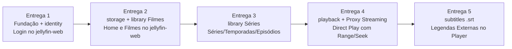

# mserver — Roadmap de Implementação (MVP e Pós-MVP)

Este documento define o plano de entregas incrementais (fatias verticais) para a implementação do **mserver**, com todos os endpoints da surface Jellyfin validados contra a especificação oficial [`docs/jellyfin-openapi-stable.json`](jellyfin-openapi-stable.json) (`x-jellyfin-version: 12.4.0`).

---

## 1. Objetivo e Diretrizes Inegociáveis do MVP

### 1.1 Objetivo do MVP

Permitir que o cliente oficial **`jellyfin-web`** se conecte ao `mserver`, autentique usando `<username ou email>#<profile>`, navegue pelo catálogo local de **Filmes** e **Séries** e reproduza mídia via **Direct Play** com **legendas externas `.srt`**, operando 100% sobre a arquitetura definitiva do projeto.

### 1.2 Regras Arquiteturais desde a Entrega 1

1. **Isolamento Total do Jellyfin e Governança de Escopo (Inegociável):**
   - **Todas as regras de negócio, conceitos, DTOs, unidades (`Ticks`), fluxos e adaptações referentes ao Jellyfin devem estar 100% isoladas dentro do plugin `plugins/api/jellyfin`.**
   - **Nenhum conceito que não foi discutido deve existir fora do plugin do Jellyfin.**
   - **Tudo o que for preciso adicionar fora de `plugins/api/jellyfin` (nos módulos de domínio, contratos `api/`, infraestrutura ou API própria `internal/server`) deve ser discutido antes.**
2. **Arquitetura ECST (Event-Carried State Transfer) completa:**
   - 1 banco SQLite isolado por módulo (`<MSERVER_DATA_DIR>/<modulo>.db`) com migrations embutidas (`go:embed`).
   - Transação propagada pelo contexto (`database.WithTx` / `database.ConnFrom`).
   - `outbox` transacional (`internal/infra/outbox`) gravando eventos na mesma transação de negócio com chave `UUIDv7` monótona.
   - Barramento de eventos em memória (`internal/infra/queue/memory`) trafegando envelopes **CloudEvents 1.0** (`queue.Envelope[T]`).
   - Operação universal `Resync(ctx, escopo)` em todos os módulos produtores de estado (`identity`, `storage`, `library`, `subtitles`).
3. **Fronteiras estritas entre módulos (`api/`):**
   - Nenhum módulo importa pacotes internos de outro módulo — apenas contratos `api/` com DTOs serializáveis ("proto-friendly") e erros de domínio tipados.
   - Apenas o módulo `storage` acessa o sistema de arquivos físico (confinado por `os.Root`). O restante do sistema referencia arquivos exclusivamente por `FileID` (`UUIDv7`).
4. **Separação estrita de Surfaces:**
   - **`internal/server` (API Própria do Projeto):** voltada à administração do servidor no MVP (qualquer rota ou contrato específico fora do que já foi acordado deve ser discutido antes).
   - **`plugins/api/jellyfin` (Plugin Surface Jellyfin):** concentra **100% das rotas e regras de negócio da API Jellyfin 12.4.0** (incluindo parse de `<username ou email>#<profile>`, `QuickConnect`, tradução para `BaseItemDto`/`MediaSources`/`MediaStreams`/`DeliveryUrl`, avaliação de `DeviceProfile`/`PlaybackInfo`, conversão para `Ticks` e stubs de compatibilidade). Nenhuma rota ou regra do Jellyfin existe fora desse plugin.
   - **`storage` HTTP Data Plane:** expõe apenas `GET /locations/{LocationID}/files/{FileID}` (com suporte a `Range`). Nas rotas de streaming de vídeo e legenda do Jellyfin, o plugin `plugins/api/jellyfin` atua como **proxy reverso em streaming** para o `storage`.
5. **Autenticação Jellyfin (`CustomAuthentication` — isolada em `plugins/api/jellyfin`):**
   - O middleware do `plugins/api/jellyfin` extrai o token tanto do header `Authorization` / `X-Emby-Authorization` (`MediaBrowser Client="...", Device="...", DeviceId="...", Version="...", Token="..."`) quanto da query string (`?api_key=<token>` ou `?ApiKey=<token>`), usada pelo navegador nas tags `<video>` e requisições de legenda.

---

## 2. Entregas do MVP (Fatias Verticais)

---

### Entrega 1 — Fundação + `identity` + Login no `jellyfin-web`

#### Escopo Técnico

- **Infraestrutura e Bootstrap (`cmd/server`, `internal/infra`, `internal/app`, `internal/server`):**
  - Carregamento de variáveis de ambiente (`MSERVER_*`) com validação de prefixos.
  - Logging estruturado (`slog`), abertura de SQLite por módulo com runner de migrations, `database.WithTx`/`ConnFrom`.
  - `queue` (`Envelope[T]` CloudEvents 1.0 + implementação `queue/memory`), `outbox` transacional (tabela `outbox` + relay assíncrono ordenado por `UUIDv7`), `registry.Registry[T]` e `httpserver`.
  - Ciclo de vida `app.Module` (`Name`, `Requires`, `Init`, `Start`, `Stop`) e wiring centralizado em `internal/app`.
- **Módulo `identity` (`internal/modules/identity`):**
  - Separação entre **Conta (`Account`)** e **Perfil (`Profile`)**:
    - `Account`: `account_id` (UUIDv7), `username`, `email`, `password_hash` (argon2id/bcrypt), `is_admin`, `disabled`, `created_at`.
    - `Profile`: `profile_id` (UUIDv7), `account_id`, `handle` (identificador curto único na conta), `display_name`, `created_at`.
  - Sessões e tokens de acesso vinculados a `(AccountID, ProfileID, DeviceID)`.
  - Autenticação no domínio recebendo conta (`username` ou `email`), `handle` do perfil e senha de forma estruturada (o parse da string concatenada `<username ou email>#<profile>` pertence exclusivamente ao `plugins/api/jellyfin`).
  - Emissão de eventos via `outbox` (`identity.account.created.v1`, `identity.account.updated.v1`, `identity.account.deleted.v1`, `identity.profile.created.v1`, `identity.profile.updated.v1`, `identity.profile.deleted.v1`, `identity.session.revoked.v1`) e operação `Resync(ctx)`.

> **Nota sobre `internal/server`:** Os endpoints administrativos da API própria (`internal/server`) para gerenciamento de contas, perfis, localizações e bibliotecas devem ser discutidos antes de serem adicionados.

#### Endpoints Jellyfin (`plugins/api/jellyfin`) — Validados no OpenAPI 12.4.0

| Método        | Rota (`jellyfin-openapi-stable.json`)        | `operationId`                                       | Request / Params                                                                   | Response Schema                                                                                                                | Observação                                                                                         |
| :------------ | :------------------------------------------- | :-------------------------------------------------- | :--------------------------------------------------------------------------------- | :----------------------------------------------------------------------------------------------------------------------------- | :------------------------------------------------------------------------------------------------- |
| `GET`         | `/System/Info/Public`                        | `GetPublicSystemInfo`                               | —                                                                                  | `PublicSystemInfo` (`Id`, `ServerName`, `Version: "12.4.0"`, `ProductName: "Jellyfin Server"`, `StartupWizardCompleted: true`) | Primeiro endpoint chamado pelo `jellyfin-web` ao conectar.                                         |
| `GET`, `POST` | `/System/Ping`                               | `GetPingSystem`, `PostPingSystem`                   | —                                                                                  | `string` (Nome do servidor)                                                                                                    | Healthcheck do cliente.                                                                            |
| `GET`         | `/System/Info`                               | `GetSystemInfo`                                     | Auth Header                                                                        | `SystemInfo`                                                                                                                   | Chamado após autenticação.                                                                         |
| `GET`         | `/Branding/Configuration`                    | `GetBrandingOptions`                                | —                                                                                  | `BrandingOptionsDto` (`LoginDisclaimer`, `CustomCss`, `SplashscreenEnabled: false`)                                            | Configuração visual da tela de login.                                                              |
| `GET`         | `/Branding/Css` e `/Branding/Css.css`        | `GetBrandingCss`, `GetBrandingCss_2`                | —                                                                                  | `204 No Content`                                                                                                               | Evita erro 404 de folha de estilo customizada.                                                     |
| `GET`         | `/QuickConnect/Enabled`                      | `GetQuickConnectEnabled`                            | —                                                                                  | `boolean` (`false`)                                                                                                            | Desabilita botão de QuickConnect no `jellyfin-web` durante o MVP.                                  |
| `GET`         | `/Users/Public`                              | `GetPublicUsers`                                    | —                                                                                  | `UserDto[]` (`[]`)                                                                                                             | Lista vazia força o `jellyfin-web` a exibir o formulário manual de login.                          |
| `POST`        | `/Users/AuthenticateByName`                  | `AuthenticateUserByName`                            | Body: `AuthenticateUserByName` (`Username`: `<user/email>#<profile>`, `Pw`: senha) | `AuthenticationResult` (`User`: `UserDto` mapeado do `ProfileID`, `SessionInfo`: `SessionInfoDto`, `AccessToken`, `ServerId`)  | Autentica na `Account` e cria sessão vinculada ao `ProfileID`.                                     |
| `GET`         | `/Users/Me`                                  | `GetCurrentUser`                                    | Auth Header                                                                        | `UserDto`                                                                                                                      | Retorna o `UserDto` correspondente ao `ProfileID` da sessão.                                       |
| `GET`         | `/Users/{userId}`                            | `GetUserById`                                       | Path: `userId` (`ProfileID`)                                                       | `UserDto`                                                                                                                      | Consulta do perfil logado pelo `jellyfin-web`.                                                     |
| `POST`        | `/Sessions/Capabilities/Full`                | `PostFullCapabilities`                              | Query: `id`; Body: `ClientCapabilitiesDto`                                         | `204 No Content`                                                                                                               | Registro de capacidades do cliente logo após o login.                                              |
| `POST`        | `/Sessions/Logout`                           | `ReportSessionEnded`                                | Auth Header                                                                        | `204 No Content`                                                                                                               | Revoga a sessão/token atual no `identity`.                                                         |
| `GET`, `POST` | `/DisplayPreferences/{displayPreferencesId}` | `GetDisplayPreferences`, `UpdateDisplayPreferences` | Path: `displayPreferencesId` (`usersettings`); Query: `userId`, `client`           | `GET`: `DisplayPreferencesDto` (default); `POST`: `204 No Content`                                                             | **Stub obrigatório:** o `jellyfin-web` exige esse endpoint para concluir o carregamento pós-login. |

#### Critério de Aceite (Entrega 1)

1. Executar `POST /api/v1/setup` criando a conta `admin` e o perfil `lucas` (e verificar que uma segunda chamada a `/api/v1/setup` retorna `409 Conflict`).
2. Abrir o `jellyfin-web`, conectar ao servidor, fazer login com `admin#lucas` + senha e carregar a tela inicial do `jellyfin-web` sem erros.

---

### Entrega 2 — `storage` + `library` (Filmes) + Navegação no `jellyfin-web`

#### Escopo Técnico

- **Wrapper `ffprobe` (`internal/infra/ffmpeg`):**
  - Execução via `os/exec` e parsing do JSON de container, duração, bitrate e streams (`video`, `audio`, `subtitle`) em tipos de domínio agnósticos (conversão para `Ticks` e `MediaStreams` ocorre apenas em `plugins/api/jellyfin`).
- **Módulo `storage` (`internal/modules/storage`) + Plugin `plugins/storage/ffprobe`:**
  - Driver `local` confinado com `os.Root`.
  - Cadastro de localizações (`LocationID`, validação impedindo sobreposição de diretórios).
  - Indexação em 2 fases:
    1. Registro rápido: gera `FileID` (`UUIDv7`), grava tamanho, `mtime` e `inode`, detecta renomeações/movimentações pelo `inode` e emite `storage.file.indexed.v1`, `storage.file.changed.v1`, `storage.file.moved.v1`, `storage.file.removed.v1` via `outbox`.
    2. Análise assíncrona: executa o plugin `ffprobe` em arquivos de vídeo estáveis e emite `storage.file.analyzed.v1` via `outbox`.
  - Operação `Resync(ctx, LocationID)` republicando `FileIndexed` e `FileAnalyzed` de todos os arquivos da localização.
- **Módulo `library` (`internal/modules/library` — Escopo Filmes):**
  - Cadastro de bibliotecas (`LibraryID`, nome, tipo de mídia filmes, vínculo com um ou mais `LocationID`s).
  - Ao cadastrar uma biblioteca, invoca `storage.Resync(ctx, LocationID)`.
  - Consome eventos `storage.file.*`, aplica o parser regex de filmes (`Título (Ano)`) sobre o caminho relativo e gera `MovieID` determinístico (derivado do `FileID`).
  - Consolida as informações técnicas das faixas no modelo de domínio da `library` ao receber `storage.file.analyzed.v1` (a tradução para `MediaSources` e `MediaStreams` do Jellyfin fica isolada em `plugins/api/jellyfin`).
  - Emite `library.movie.added.v1`, `library.movie.updated.v1`, `library.movie.removed.v1` via `outbox` e implementa `Resync(ctx, LibraryID)`.

#### Endpoints Jellyfin (`plugins/api/jellyfin`) — Validados no OpenAPI 12.4.0

| Método | Rota (`jellyfin-openapi-stable.json`) | `operationId`    | Request / Params Principais                                                                                                                                                         | Response Schema                                                                                            | Observação                                                              |
| :----- | :------------------------------------ | :--------------- | :---------------------------------------------------------------------------------------------------------------------------------------------------------------------------------- | :--------------------------------------------------------------------------------------------------------- | :---------------------------------------------------------------------- |
| `GET`  | `/UserViews`                          | `GetUserViews`   | Query: `userId`, `includeExternalContent`                                                                                                                                           | `BaseItemDtoQueryResult` (`Items`: bibliotecas com `Type: "CollectionFolder"`, `CollectionType: "movies"`) | Exibe os cards "Minha Mídia" e o menu lateral na Home.                  |
| `GET`  | `/Items`                              | `GetItems`       | Query: `userId`, `parentId`, `includeItemTypes` (`Movie`), `recursive`, `sortBy`, `sortOrder`, `startIndex`, `limit`, `fields` (`MediaSources`, `MediaStreams`, `Path`, `Overview`) | `BaseItemDtoQueryResult`                                                                                   | Listagem paginada de filmes (com `UserData: UserItemDataDto` zerado).   |
| `GET`  | `/Items/Latest`                       | `GetLatestMedia` | Query: `userId`, `parentId`, `includeItemTypes`, `limit`, `fields`                                                                                                                  | `BaseItemDto[]` (**Retorna array direto**, não `QueryResult`)                                              | Alimenta a seção "Adicionados Recentemente" na Home.                    |
| `GET`  | `/Items/{itemId}`                     | `GetItem`        | Path: `itemId` (`MovieID`); Query: `userId`                                                                                                                                         | `BaseItemDto` (inclui `MediaSources` e `MediaStreams` do `ffprobe`)                                        | Página de detalhes do filme (resolução, codecs, áudio, duração).        |
| `GET`  | `/Items/{itemId}/Intros`              | `GetIntros`      | Path: `itemId`; Query: `userId`                                                                                                                                                     | `BaseItemDtoQueryResult` (`Items: []`, `TotalRecordCount: 0`)                                              | Stub vazio chamado antes da reprodução.                                 |
| `GET`  | `/UserItems/Resume`                   | `GetResumeItems` | Query: `userId`, `parentId`, `mediaTypes`, `limit`                                                                                                                                  | `BaseItemDtoQueryResult` (`Items: []`, `TotalRecordCount: 0`)                                              | **Stub MVP:** retorna lista vazia na Home enquanto não há `watchstate`. |

#### Critério de Aceite (Entrega 2)

1. Cadastrar uma localização de filmes e uma biblioteca do tipo `movies` via API administrativa.
2. Verificar no `jellyfin-web` a biblioteca aparecendo em "Minha Mídia", os filmes em "Adicionados Recentemente" e abrir a página de detalhes de um filme exibindo duração e faixas de vídeo/áudio extraídas pelo `ffprobe`.

---

### Entrega 3 — `library` (Séries) + Navegação de Séries no `jellyfin-web`

#### Escopo Técnico

- **Módulo `library` (`internal/modules/library` — Escopo Séries):**
  - Suporte ao tipo de biblioteca `tvshows` (`series`).
  - Parser regex completo de séries coberto por testes baseados em tabela:
    - Extração de série (título e ano) pela pasta de primeiro nível (agrupando episódios de uma mesma série mesmo em múltiplos diretórios).
    - Extração de temporada por prioridade: (1) nome do arquivo (`S02E05`), (2) pasta de temporada (`Season 01`, `S01`), (3) fallback para temporada única.
    - Suporte a especiais (`Season 00` / `Specials` / `S00Exx`).
    - Suporte a episódios múltiplos (`S01E01E02`, `S01E01-E02` → `IndexNumber` e `IndexNumberEnd`).
    - Suporte a numeração absoluta de anime (`Serie - 105.mkv` → temporada única + número absoluto).
    - Suporte a episódios sem número identificado (`IndexNumber` nulo) e ordenação natural (`ep2` antes de `ep10`).
  - `EpisodeID` determinístico (**UUIDv5 derivado do `FileID`**); `SeriesID` e `SeasonID` gerados com **UUIDv7** (remoção automática de temporadas e séries que ficarem sem episódios).
  - Emissão dos eventos `library.series.*`, `library.season.*` e `library.episode.*` via `outbox`.

#### Endpoints Jellyfin (`plugins/api/jellyfin`) — Validados no OpenAPI 12.4.0

- Atualização de `GET /UserViews` (`CollectionType: "tvshows"`), `GET /Items`, `GET /Items/Latest` e `GET /Items/{itemId}` para suportar `BaseItemKind`: `Series`, `Season` e `Episode`.
- Adição das rotas de `Shows`:

| Método | Rota (`jellyfin-openapi-stable.json`) | `operationId` | Request / Params Principais                                                                             | Response Schema                                                                                        | Observação                                                    |
| :----- | :------------------------------------ | :------------ | :------------------------------------------------------------------------------------------------------ | :----------------------------------------------------------------------------------------------------- | :------------------------------------------------------------ |
| `GET`  | `/Shows/{seriesId}/Seasons`           | `GetSeasons`  | Path: `seriesId`; Query: `userId`, `fields`, `isSpecialSeason`                                          | `BaseItemDtoQueryResult` (`Items`: temporadas ordenadas, incluindo `Season 00`)                        | Lista as temporadas na página da série.                       |
| `GET`  | `/Shows/{seriesId}/Episodes`          | `GetEpisodes` | Path: `seriesId`; Query: `userId`, `seasonId`, `season`, `startItemId`, `startIndex`, `limit`, `fields` | `BaseItemDtoQueryResult` (`Items`: episódios com `IndexNumber`, `IndexNumberEnd`, `ParentIndexNumber`) | Lista os episódios da temporada e monta a fila de reprodução. |
| `GET`  | `/Shows/NextUp`                       | `GetNextUp`   | Query: `userId`, `seriesId`, `parentId`, `limit`                                                        | `BaseItemDtoQueryResult` (`Items: []`, `TotalRecordCount: 0`)                                          | **Stub MVP:** retorna lista vazia na Home e na tela da série. |

#### Critério de Aceite (Entrega 3)

1. Cadastrar uma localização e biblioteca de séries (`tvshows`) contendo séries padrão, especiais (`Season 00`), episódios duplos e animes em numeração absoluta.
2. Navegar no `jellyfin-web` por Série → Temporada → Episódio e inspecionar os detalhes técnicos de cada episódio.

---

### Entrega 4 — `playback` (Direct Play) + HTTP do `storage` + Proxy de Streaming no Jellyfin

#### Escopo Técnico

- **Servidor HTTP de Dados do `storage` (`internal/modules/storage`):**
  - Implementa `GET /locations/{LocationID}/files/{FileID}` e `HEAD /locations/{LocationID}/files/{FileID}`.
  - Serve o arquivo físico a partir do driver `local` (`os.Root`) com suporte completo a `Range` (`206 Partial Content`, `Accept-Ranges: bytes`, `Content-Length`, `Content-Type`, `Last-Modified`).
  - `storage.Resolve(ctx, FileID, consumer)` retorna a URL HTTP interna `/locations/{LocationID}/files/{FileID}` (ou localização correspondente).
- **Módulo `playback` (`internal/modules/playback`):**
  - Gerenciamento em memória das sessões de reprodução ativas (início, progresso, pausa, retomada, heartbeat e encerramento) com detecção de timeout por inatividade, operando sobre tipos de domínio próprios (sem conhecer `DeviceProfile` ou `Ticks` do Jellyfin).
  - Emissão de eventos via `outbox`: `playback.session.started.v1`, `playback.session.progressed.v1`, `playback.session.paused.v1`, `playback.session.resumed.v1` e `playback.session.stopped.v1`.
- **Regras de `PlaybackInfo` e Proxy de Streaming isoladas no `plugins/api/jellyfin`:**
  - Avalia o `DeviceProfile` enviado pelo cliente Jellyfin em `POST/GET /Items/{itemId}/PlaybackInfo` frente às informações técnicas do item na `library`, montando `PlaybackInfoResponse` (`MediaSources` com `SupportsDirectPlay: true`, `SupportsDirectStream: true`, `SupportsTranscoding: false`, `Protocol: "File"`, `PlaySessionId` ou `ErrorCode: "NoCompatibleStream"`).
  - Nas rotas `GET/HEAD /Videos/{itemId}/stream` e `/Videos/{itemId}/stream.{container}`, valida o token (via header ou query `api_key`), resolve o `(LocationID, FileID)` do item e faz **proxy reverso em streaming** para `GET /locations/{LocationID}/files/{FileID}` no `storage`, preservando `Range` na ida e `Content-Range`, `Content-Length`, `Accept-Ranges` e status `200`/`206` na volta.

#### Endpoints do `storage` (Plano de Dados Interno)

| Método        | Rota                                     | Descrição                                                                            |
| :------------ | :--------------------------------------- | :----------------------------------------------------------------------------------- |
| `GET`, `HEAD` | `/locations/{LocationID}/files/{FileID}` | Stream de bytes do arquivo com suporte a `Range` (`200 OK` / `206 Partial Content`). |

#### Endpoints Jellyfin (`plugins/api/jellyfin`) — Validados no OpenAPI 12.4.0

| Método        | Rota (`jellyfin-openapi-stable.json`)                             | `operationId`                                                                                  | Request / Params Principais                                                                                                                                                              | Response Schema                                                                                                                                                         | Observação                                                                             |
| :------------ | :---------------------------------------------------------------- | :--------------------------------------------------------------------------------------------- | :--------------------------------------------------------------------------------------------------------------------------------------------------------------------------------------- | :---------------------------------------------------------------------------------------------------------------------------------------------------------------------- | :------------------------------------------------------------------------------------- |
| `POST`, `GET` | `/Items/{itemId}/PlaybackInfo`                                    | `GetPostedPlaybackInfo`, `GetPlaybackInfo`                                                     | Path: `itemId`; Query: `userId`, `maxStreamingBitrate`, `startTimeTicks`, `audioStreamIndex`, `subtitleStreamIndex`, `mediaSourceId`; Body (`POST`): `PlaybackInfoDto` (`DeviceProfile`) | `PlaybackInfoResponse` (`MediaSources` com `SupportsDirectPlay: true`, `SupportsDirectStream: true`, `SupportsTranscoding: false`, `Protocol: "File"`, `PlaySessionId`) | Avalia `DeviceProfile` no `plugins/api/jellyfin`.                                      |
| `GET`, `HEAD` | `/Videos/{itemId}/stream` e `/Videos/{itemId}/stream.{container}` | `GetVideoStream`, `HeadVideoStream`, `GetVideoStreamByContainer`, `HeadVideoStreamByContainer` | Path: `itemId`, `container`; Query: `static`, `mediaSourceId`, `playSessionId`, `api_key`; Header: `Range`                                                                               | `200 OK` ou `206 Partial Content` (`video/*`)                                                                                                                           | **Proxy em streaming** para `GET /locations/{LocationID}/files/{FileID}` no `storage`. |
| `POST`        | `/Sessions/Playing`                                               | `ReportPlaybackStart`                                                                          | Body: `PlaybackStartInfo` (`ItemId`, `MediaSourceId`, `PlaySessionId`, `PlayMethod`, `PositionTicks`, `AudioStreamIndex`, `SubtitleStreamIndex`)                                         | `204 No Content`                                                                                                                                                        | Inicia sessão no `playback` e emite `playback.session.started.v1`.                     |
| `POST`        | `/Sessions/Playing/Progress`                                      | `ReportPlaybackProgress`                                                                       | Body: `PlaybackProgressInfo` (`ItemId`, `PlaySessionId`, `PositionTicks`, `IsPaused`, `EventName`)                                                                                       | `204 No Content`                                                                                                                                                        | Atualiza posição/pausa e emite `PlaybackProgressed`/`Paused`/`Resumed`.                |
| `POST`        | `/Sessions/Playing/Ping`                                          | `PingPlaybackSession`                                                                          | Query: `playSessionId` (required)                                                                                                                                                        | `204 No Content`                                                                                                                                                        | Mantém o heartbeat da sessão ativa.                                                    |
| `POST`        | `/Sessions/Playing/Stopped`                                       | `ReportPlaybackStopped`                                                                        | Body: `PlaybackStopInfo` (`ItemId`, `PlaySessionId`, `PositionTicks`)                                                                                                                    | `204 No Content`                                                                                                                                                        | Encerra sessão e emite `playback.session.stopped.v1`.                                  |
| `GET`         | `/GetUtcTime`                                                     | `GetUtcTime`                                                                                   | —                                                                                                                                                                                        | `UtcTimeResponse` (`RequestReceptionTime`, `ResponseTransmissionTime`)                                                                                                  | Sincronização de relógio do player no `jellyfin-web`.                                  |

#### Critério de Aceite (Entrega 4)

1. Dar Play em um filme e em um episódio pelo `jellyfin-web`.
2. Avançar/retroceder na barra de tempo (seek via `Range` / `206 Partial Content`), pausar, retomar e fechar o player, verificando a emissão dos eventos `playback.session.*`.

---

### Entrega 5 — `subtitles` (Legendas Externas `.srt`) + Proxy de Legendas no Jellyfin

#### Escopo Técnico

- **Módulo `subtitles` (`internal/modules/subtitles`):**
  - Escuta `storage.file.indexed.v1`, `storage.file.moved.v1` e `storage.file.removed.v1` filtrando arquivos `.srt` (extraindo nome base, código de idioma BCP-47 como `pt-BR`/`en` e flags `forced`/`sdh`/`hi` via regex).
  - Escuta `library.movie.added.v1`, `library.movie.updated.v1`, `library.movie.removed.v1` e `library.episode.added.v1`, `library.episode.updated.v1`, `library.episode.removed.v1` para manter sua projeção local de itens de mídia.
  - Realiza o **match bidirecional** (tanto quando o `.srt` é indexado antes do vídeo quanto quando é indexado depois).
  - Emite `subtitles.subtitle.added.v1` e `subtitles.subtitle.removed.v1` via `outbox`, além de implementar `Resync(ctx)`.
- **Consolidação na `library` e exposição isolada no `plugins/api/jellyfin`:**
  - A `library` consome `subtitles.subtitle.added.v1` / `removed.v1` e vincula as legendas externas `.srt` ao item em seu modelo de domínio próprio.
  - O plugin `plugins/api/jellyfin` traduz essas legendas para `MediaStreams` do Jellyfin (`Type: "Subtitle"`, `Codec: "srt"`, `IsExternal: true`, `SupportsExternalStream: true`, `DeliveryMethod: "External"`, `DeliveryUrl: "/Videos/{itemId}/{mediaSourceId}/Subtitles/{index}/Stream.srt"`) e serve as rotas de legenda fazendo **proxy em streaming** para `GET /locations/{LocationID}/files/{FileID}` do arquivo `.srt` no `storage`.

#### Endpoints Jellyfin (`plugins/api/jellyfin`) — Validados no OpenAPI 12.4.0

| Método | Rota (`jellyfin-openapi-stable.json`)                                                                              | `operationId`          | Request / Params Principais                                                                                                 | Response Schema                                                  | Observação                                                                                               |
| :----- | :----------------------------------------------------------------------------------------------------------------- | :--------------------- | :-------------------------------------------------------------------------------------------------------------------------- | :--------------------------------------------------------------- | :------------------------------------------------------------------------------------------------------- |
| `GET`  | `/Videos/{routeItemId}/{routeMediaSourceId}/Subtitles/{routeIndex}/Stream.{routeFormat}`                           | `GetSubtitle`          | Path: `routeItemId`, `routeMediaSourceId`, `routeIndex`, `routeFormat` (`srt`); Query: `api_key`                            | `200 OK` (`text/plain; charset=utf-8` ou `application/x-subrip`) | **Proxy em streaming** para `GET /locations/{LocationID}/files/{FileID}` do arquivo `.srt` no `storage`. |
| `GET`  | `/Videos/{routeItemId}/{routeMediaSourceId}/Subtitles/{routeIndex}/{routeStartPositionTicks}/Stream.{routeFormat}` | `GetSubtitleWithTicks` | Path: `routeItemId`, `routeMediaSourceId`, `routeIndex`, `routeStartPositionTicks`, `routeFormat` (`srt`); Query: `api_key` | `200 OK` (`text/*`)                                              | Variante com `routeStartPositionTicks` prevista na spec; aponta para o mesmo handler.                    |

#### Critério de Aceite (Entrega 5)

1. Colocar arquivos `<filme>.pt-BR.srt` e `<episodio>.en.forced.srt` junto às mídias.
2. Dar Play no `jellyfin-web`, selecionar a legenda `.srt` no seletor do player e verificar a exibição sincronizada da legenda durante a reprodução.

---

## 3. Pós-MVP (Segundo Momento)

Após a conclusão das 5 entregas do MVP, a evolução segue com:

1. **Módulo `watchstate`:**
   - Projeção da topologia do catálogo via eventos da `library` e consumo dos eventos `playback.session.*`.
   - Persistência de estado por `ProfileID` (assistido, favorito, posição, contagem de reproduções), filas de continuar assistindo e próximos episódios, contadores de itens não assistidos e histórico completo de visualizações. (A tradução para `UserData`, `GET /UserItems/Resume`, `GET /Shows/NextUp`, `/UserPlayedItems/{itemId}` e `/UserFavoriteItems/{itemId}` fica isolada em `plugins/api/jellyfin`).
2. **Módulo `transcoder` + Localizações de Sistema no `storage`:**
   - Localizações de sistema (`cache`, `transcodes`, `images`) no `storage` com `PUT`, TTL e URLs assinadas.
   - Conversão de legendas (`.srt`, `.ass`, `.ssa` → `.vtt` emitindo `transcoder.subtitle.converted.v1`).
   - Transcode de áudio HLS (`-c:v copy`) iniciado via `StartTranscode` e controlado via `SIGSTOP`/`SIGCONT`/`SIGTERM` pelos eventos do `playback`.
3. **Expansão de Clientes e Recursos no `plugins/api/jellyfin`:**
   - Homologação nos clientes `jellyfin-android` e `jellyfin-tizen`.
   - Fluxo de `QuickConnect` (`/QuickConnect/*` e `POST /Users/AuthenticateWithQuickConnect`) isolado em `plugins/api/jellyfin`, e SSO via OIDC no `identity`.
   - Protocolo `SyncPlay` (`/SyncPlay/*` + WebSocket `/socket`) em `plugins/api/jellyfin` sobre as salas compartilhadas do `playback`.
   - Extração de capítulos no `ffprobe` e segmentos de mídia expostos em `GET /MediaSegments/{itemId}` pelo `plugins/api/jellyfin`.
4. **Enriquecimento, Aquisição e Infraestrutura Distribuída:**
   - Analisadores de hash (`sha256`, `ed2k`) e `fsnotify` no `storage`.
   - Módulo `metadata` (TMDB, TVDB, AniDB, AniSkip, IntroDB) e imagens (`/Items/{itemId}/Images/{imageType}`).
   - Jobs em background no `transcoder` (thumbnails, imagens de capítulos, _trickplay_, detecção de abertura/créditos por `chromaprint`).
   - Pipeline de aquisição (`indexer`, `downloader`, `acquisition`), `translation` e `notification`.
   - Adaptadores gRPC (`bufconn` / TCP) para execução distribuída.
